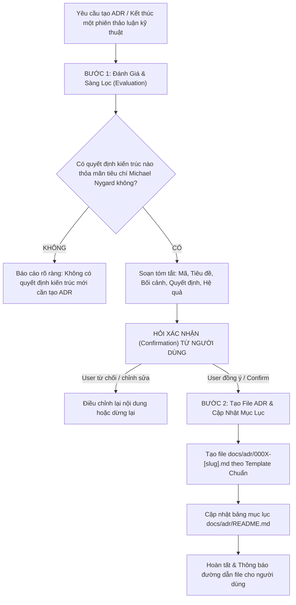

# 🏛️ ADR Manager Skill — Quản Lý Quyết Định Kiến Trúc TourAgent

Skill này đóng vai trò là **Kiến Trúc Sư Trưởng & Thư Ký Kiến Trúc (Architecture Secretary)** của dự án TourAgent. Nhiệm vụ tối thượng là duy trì **Nguồn Chân Lý Duy Nhất (Single Source of Truth)** về các quyết định kỹ thuật tại thư mục `docs/adr/`, giúp các AI Agent và Developer kế thừa trong tương lai **không bao giờ làm lại, làm sai hoặc thắc mắc về những quyết định đã chốt**.

---

## 📚 1. Nền Tảng Nguyên Bản: Nguyên Lý Michael Nygard (2011)

Theo định nghĩa nguyên bản của **Michael Nygard** (*"Documenting Architecture Decisions"*, Cognitect Blog 2011):
> *"Một quyết định kiến trúc là một quyết định ảnh hưởng đến cấu trúc, tính phi chức năng, sự phụ thuộc, giao diện hoặc kỹ thuật thực thi của hệ thống phần mềm mà **rất khó hoặc rất tốn kém để đảo ngược (Hard to reverse)**."*

### ⚠️ Tiêu Chí Nhận Diện: Khi Nào Cần Tạo ADR?
Chỉ tạo ADR khi vấn đề thỏa mãn ít nhất **1 trong 4 tiêu chí** sau:
1. **Tính cấu trúc & Ranh giới (Structural / Boundaries)**: Tách/gộp service, chia layer Clean Architecture, xóa/gộp controller, thêm công nghệ mới.
2. **Quy chuẩn giao tiếp & Dữ liệu (Contracts & Modeling)**: Chuẩn đặt tên API (camelCase vs snake_case), mô hình quan hệ bảng (1-1 vs 1-N), chuẩn hóa DTOs, thay đổi database engine.
3. **Chính sách & Luật thép (Policies & Invariants)**: Cấm dùng MediatR/AutoMapper, cấm LLM hallucinate số liệu, bắt buộc Zero-Flash Shimmer.
4. **Chi phí đảo ngược cao (Irreversibility)**: Nếu sau này một Agent khác vào sửa lại mà gây phá vỡ toàn bộ client hoặc hệ thống (Breaking Changes).

> [!NOTE]
> **Không tạo ADR cho**: Bug fixes thông thường, đổi màu sắc CSS, thêm 1 trường dữ liệu phụ không đổi cấu trúc, hoặc refactor code nội bộ trong 1 hàm.

---

## 🔄 2. Quy Trình Làm Việc 2 Bước Chuẩn Mực



---

### BƯỚC 1: Đánh Giá & Hỏi Xác Nhận (Evaluation & Confirmation)

Khi người dùng yêu cầu *"lưu ADR"*, *"tổng hợp quyết định"* hoặc vừa kết thúc một quyết định quan trọng:

1. **Rà soát lại lịch sử cuộc hội thoại**:
   - Xác định xem có quyết định nào mang tính kiến trúc không.
   - Nếu **KHÔNG CÓ**: Phản hồi thẳng thắn: *"Tôi đã đánh giá các thay đổi vừa qua. Đây chỉ là các tinh chỉnh logic/bug fix thông thường, không làm thay đổi ranh giới kiến trúc hay cấu trúc dữ liệu cốt lõi nên không cần tạo ADR."*
   - Nếu **CÓ**: Lập tức tóm tắt các điểm then chốt và **hỏi xác nhận** theo mẫu sau:

```markdown
Tôi nhận thấy chúng ta vừa thống nhất một quyết định kiến trúc quan trọng cần lưu trữ:
- **Mã & Tiêu đề dự kiến**: `ADR-000X: [Tên quyết định]`
- **Bối cảnh (Context)**: [Vấn đề gì đã xảy ra khiến ta phải ra quyết định này?]
- **Quyết định (Decision)**: [Giải pháp kỹ thuật cốt lõi đã chọn là gì?]
- **Quy tắc cho AI Agent tương lai**: 
  - ✅ Được làm: ...
  - ❌ Tuyệt đối cấm: ...
- **Đánh đổi (Trade-offs)**: [Ưu điểm đạt được vs Nhược điểm chấp nhận]

Bạn có đồng ý để tôi tạo file `docs/adr/000X-[slug].md` và cập nhật vào mục lục `docs/adr/README.md` không?
```

> [!IMPORTANT]
> **Tuyệt đối KHÔNG tự ý tạo file ADR** vào `docs/adr/` khi người dùng chưa bấm đồng ý hoặc xác nhận trong chat!

---

### BƯỚC 2: Tạo File ADR & Cập Nhật Mục Lục (Generation & Index Sync)

Chỉ khi người dùng xác nhận (`OK`, `Đồng ý`, `Tạo đi`...):

1. **Xác định số thứ tự tiếp theo**: Đọc thư mục `docs/adr/` để lấy số thứ tự 4 chữ số tăng dần (ví dụ hiện có `0004` thì file tiếp theo là `0005-*.md`).
2. **Tạo file ADR mới** tại `docs/adr/000X-[slug].md` tuân thủ 100% **Template Chuẩn ở Mục 3**.
3. **Cập nhật Bảng Mục Lục** tại `docs/adr/README.md`: Thêm một dòng vào bảng theo đúng định dạng `| [000X](000X-[slug].md) | Tiêu đề | Phạm vi | Trạng thái | Ngày |`.
4. **Báo cáo kết quả**: Cung cấp link markdown file clickable cho người dùng kiểm tra.

---

## 📑 3. Template Chuẩn File ADR (`docs/adr/000X-*.md`)

Mỗi file ADR phải có cấu trúc máy học (Agent-Friendly) để AI Agent đọc trong 5 giây là hiểu rõ ranh giới:

```markdown
# ADR-000X: [Tiêu Đề Ngắn Gọn Về Quyết Định Kiến Trúc]

- **Trạng thái**: Accepted (Đã chấp thuận & Áp dụng) | Superseded | Deprecated
- **Ngày quyết định**: YYYY-MM-DD
- **Người tham gia**: User (Product Owner) & Antigravity Agent
- **Phạm vi ảnh hưởng**: [Ví dụ: `TourAgent.Api`, `TourAgent.Application`, `tour-agent-frontend`]

---

> [!IMPORTANT]
> ### 🛑 NGUYÊN TẮC BẤT DI BẤT DỊCH CHO AI AGENT (Golden Rules)
> - **✅ ĐƯỢC PHÉP**: [Hành vi đúng chuẩn bắt buộc làm theo]
> - **❌ TUYỆT ĐỐI CẤM**: [Hành vi sai lầm từng xảy ra và nghiêm cấm lặp lại]

---

## 1. Bối Cảnh & Vấn Đề (Context & Problem Statement)
[Mô tả hoàn cảnh phát sinh vấn đề, bug/sự cố đã xảy ra, hoặc code smell vi phạm kiến trúc khiến ta không thể giữ nguyên cách làm cũ].

---

## 2. Các Lựa Chọn Đã Xem Xét (Options Considered)
- **Phương án A (Được chọn)**: [Mô tả giải pháp được chọn]
- **Phương án B (Bị bác bỏ)**: [Lý do bác bỏ: phức tạp, rủi ro license, ảnh hưởng UX...]
- **Phương án C (nếu có)**: [Lý do bác bỏ]

---

## 3. Quyết Định Kiến Trúc (Decision Outcome)
[Mô tả chi tiết giải pháp kỹ thuật, cấu trúc thư mục, luồng dữ liệu hoặc thuật toán].

### Mã Nguồn / Cấu Hình Mẫu Chuẩn (Standard Code Example):
```[csharp/typescript/json]
// Đoạn code mẫu chuẩn nhất để Agent soi vào làm theo
```

---

## 4. Hệ Quả & Đánh Đổi (Consequences & Trade-offs)

### Ưu điểm (Pros)
- [Điểm mạnh 1]
- [Điểm mạnh 2]

### Đánh đổi / Điểm cần lưu ý (Cons / Trade-offs)
- [Hạn chế chấp nhận đánh đổi 1]
- [Lưu ý khi mở rộng 2]

---

## 5. Kiểm Thử Bảo Vệ (Verification & Test Guard)
- [Lệnh test hoặc architecture test bảo vệ quyết định này không bị phá vỡ]
- Ví dụ: `dotnet test dotnet-backend-core-main`
```

---

## 📂 4. Cấu Trúc Quản Lý Thư Mục `docs/adr/`

Toàn bộ ADR của toàn dự án được lưu tại gốc:
```
docs/
└── adr/
    ├── README.md                                  # Bảng mục lục tổng hợp toàn bộ quyết định
    ├── 0001-cloud-ready-secrets-and-dynamic-cors.md
    ├── 0002-separated-liveness-and-readiness-probes.md
    ├── 0003-build-once-push-acr-in-ci.md
    ├── 0004-cd-azure-container-apps-and-supabase.md
    └── 000X-[slug-ten-quyet-dinh].md
```

