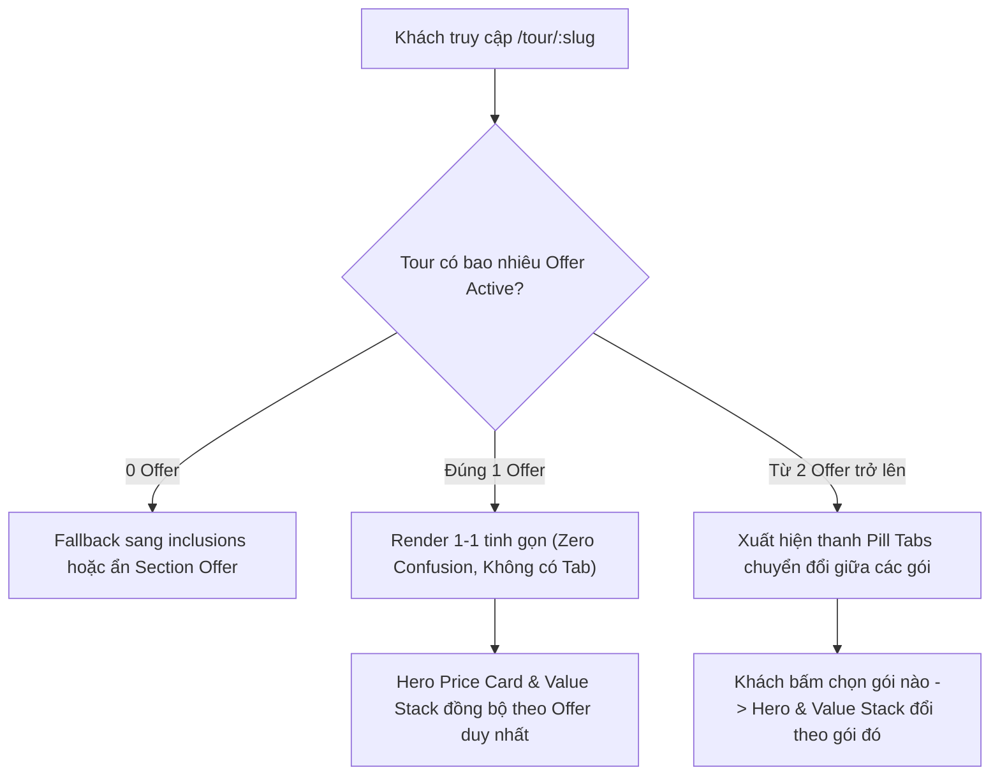

# ADR-0006: Mô Hình Hybrid 80/20 Adaptive UI Cho Quan Hệ Tour — Offer

- **Trạng thái**: Accepted (Đã chấp thuận & Áp dụng)
- **Ngày quyết định**: 2026-11-24
- **Người tham gia**: User (Product Owner) & Antigravity Agent
- **Phạm vi ảnh hưởng**: `TourAgent.Domain/Offers`, `TourAgent.Application/Features/Tours`, `tour-agent-frontend` (`TourProductPage.tsx`)

---

> [!IMPORTANT]
> ### 🛑 NGUYÊN TẮC BẤT DI BẤT DỊCH CHO AI AGENT (Golden Rules)
> - **✅ ĐƯỢC PHÉP**: 
>   - Giữ nguyên quan hệ 1-N giữa Tour (`travels`) và Offer (`offers`) trong Database. Bảng `offers` có khóa ngoại `travel_id`.
>   - Trên Frontend (`/tour/:slug`), giao diện tự động thích ứng (Adaptive UI):
>     - **Nếu có 0 Offer**: Fallback hiển thị quyền lợi từ `tour.inclusions` hoặc ẩn section nếu không có dữ liệu.
>     - **Nếu có đúng 1 Offer (80% trường hợp)**: Hiển thị giao diện 1-1 tinh gọn, tuyệt đối KHÔNG hiển thị thanh Tab thừa.
>     - **Nếu có từ 2 Offer trở lên (20% tour chiến lược)**: Tự động hiển thị thanh chuyển đổi Pill Tabs giữa các gói (`[🌸 Gói Tiêu Chuẩn] [💎 Gói VIP]`).
> - **❌ TUYỆT ĐỐI CẤM**:
>   - CẤM xóa bảng `offers` hoặc cắt giảm quan hệ DB về 1-1 cứng (`UNIQUE(travel_id)`).
>   - CẤM ép buộc giao diện hiển thị 3 cột so sánh cứng nhắc khi tour chỉ có 1 offer, gây chật chội và thừa thãi trên màn hình khách xem.

---

## 1. Bối Cảnh & Vấn Đề (Context & Problem Statement)

Trong hệ thống TourAgent:
- **Tour (Core Product)**: Chứa thông số kỹ thuật (lịch trình 6N5Đ, chuyến bay, khách sạn, chính sách visa).
- **Offer (Grand Slam Offer)**: Chứa mức giá bán, bảng xếp chồng giá trị (Value Stack), quà tặng kèm (Bonuses) và cam kết bảo hành (Guarantees).

Người dùng đặt ra câu hỏi kiến trúc:
> *"1 Tour có nhiều Offer là tốt, nhưng có làm phức tạp dữ liệu và UI không? Có nên cắt giảm về quan hệ 1-1 cứng để UI đơn giản hơn không?"*

---

## 2. Các Lựa Chọn Đã Xem Xét (Options Considered)

- **Phương án 1: Cắt về 1-1 cứng (1 Tour = Đúng 1 Offer)**:
  - *Bác bỏ vì*: Làm mất tính linh hoạt marketing. Khi muốn bán gói Tiêu Chuẩn và gói VIP cho cùng 1 chuyến đi, admin buộc phải tạo 2 tour trùng lặp lịch trình. Đồng thời gây lãng phí code `OffersController` và migration đã làm.
- **Phương án 2: Ép buộc 3 Cột So Sánh (Tiered Pricing Cards như SaaS)**:
  - *Bác bỏ vì*: Trên mobile rất chật chội; nếu tour chỉ có 1 gói thì UI 3 cột bị méo mó.
- **Phương án 3: Mô Hình Hybrid 80/20 Adaptive UI (Được chọn)**:
  - Giữ 1-N ở DB. Trên UI tự động thích ứng theo số lượng Offer thực tế.

---

## 3. Quyết Định Kiến Trúc (Decision Outcome)



### Mã Nguồn Mẫu Chuẩn (Standard Code Example):

**Frontend (`TourProductPage.tsx`)**:
```tsx
const offers: OfferDto[] = Array.isArray(tour.offers) ? tour.offers : [];
const hasMultipleOffers = offers.length > 1;
const currentOffer = offers.length > 0 ? offers[selectedOfferIndex] || offers[0] : null;

// Giá và cọc ưu tiên tính theo currentOffer
const priceFrom = currentOffer?.pricing?.offerPrice ?? tour.priceFrom;
const depositAmount = currentOffer?.pricing?.depositAmount ?? Math.round(priceFrom * 0.3);

// Chỉ render Pill Tabs khi có từ 2 Offer trở lên
{hasMultipleOffers && (
  <div className="flex flex-wrap items-center justify-center gap-2.5 mb-8">
    {offers.map((off, idx) => (
      <button
        key={off.id}
        onClick={() => setSelectedOfferIndex(idx)}
        className={selectedOfferIndex === idx ? 'pill-active' : 'pill-inactive'}
      >
        <span>{off.isFeatured ? '💎' : '🌸'}</span>
        <span>{off.title}</span>
      </button>
    ))}
  </div>
)}
```

---

## 4. Hệ Quả & Đánh Đổi (Consequences & Trade-offs)

### Ưu điểm (Pros)
- Đạt được sự hoàn hảo: Đơn giản cho tour thông thường (1-1) và mạnh mẽ cho tour chiến lược (Upsell VIP).
- Zero breaking change đối với Database schema hiện tại.
- Hỗ trợ AI Agent tư vấn bán hàng đa gói theo ngữ cảnh khách hàng.

### Đánh đổi (Cons)
- Frontend cần quản lý state `selectedOfferIndex` để đồng bộ giữa Hero card và Section Offer.

---

## 5. Kiểm Thử Bảo Vệ (Verification & Test Guard)

- `cmd /c "npm --prefix tour-agent-frontend run build"` (0 lỗi compile TypeScript).
- `dotnet test dotnet-backend-core-main` (126 tests).

