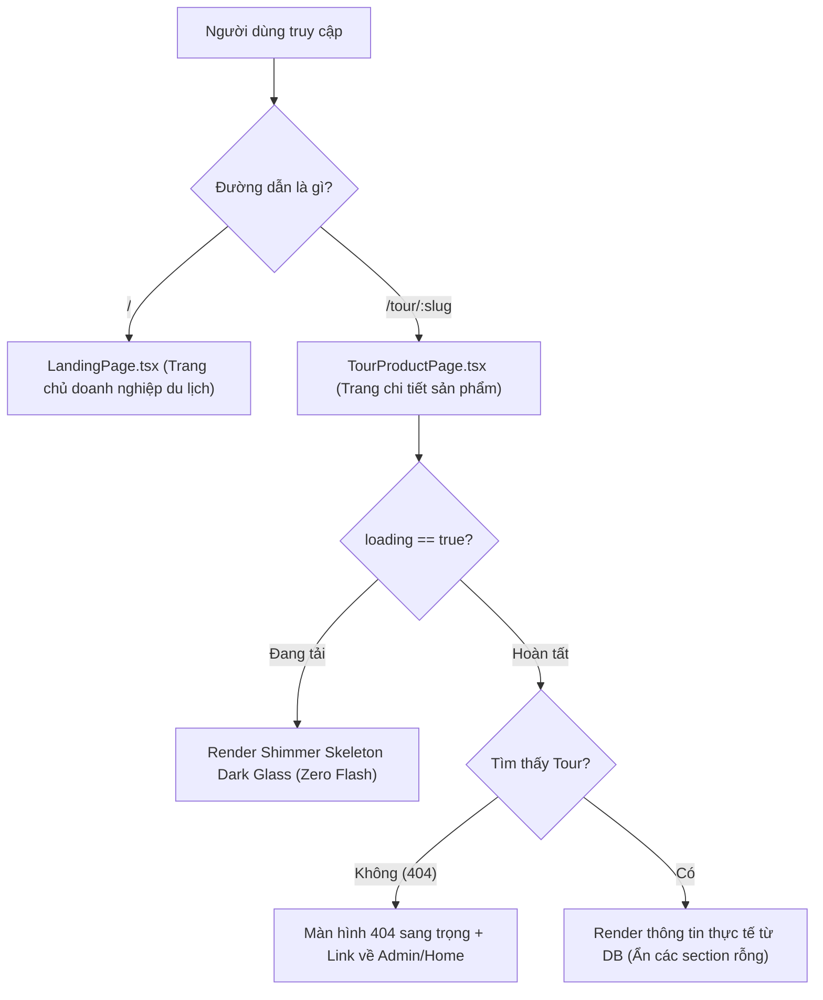

# ADR-0008: Tách Biệt Route /tour/:slug & Shimmer Skeleton Triệt Tiêu Flash (FOUC)

- **Trạng thái**: Accepted (Đã chấp thuận & Áp dụng)
- **Ngày quyết định**: 2026-11-24
- **Người tham gia**: User (Product Owner) & Antigravity Agent
- **Phạm vi ảnh hưởng**: `tour-agent-frontend` (`LandingPage.tsx`, `TourProductPage.tsx`, `App.tsx`)

---

> [!IMPORTANT]
> ### 🛑 NGUYÊN TẮC BẤT DI BẤT DỊCH CHO AI AGENT (Golden Rules)
> - **✅ ĐƯỢC PHÉP**: 
>   - Trang chủ công ty (`/`) dùng riêng component **`LandingPage.tsx`**.
>   - Trang chi tiết sản phẩm theo slug (`/tour/:slug`) dùng riêng component **`TourProductPage.tsx`**.
>   - Bắt buộc hiển thị Shimmer Loading Skeleton trong lúc nạp dữ liệu từ backend (`loading = true`).
>   - Áp dụng Conditional Rendering: Section nào không có dữ liệu thực tế từ DB thì **ẩn hoàn toàn**, đồng thời tự động ẩn link trên Navbar & Footer.
> - **❌ TUYỆT ĐỐI CẤM**:
>   - CẤM gộp chung trang chủ `/` và trang sản phẩm `/tour/:slug` vào một file component duy nhất.
>   - CẤM khởi tạo state bằng dữ liệu mẫu (mock data như `DEFAULT_REVIEWS`, `DEFAULT_FAQS`, `DEFAULT_VALUE_STACK` hay ảnh Unsplash giả) khiến màn hình bị chớp nháy (Flash of Default Content - FOUC).

---

## 1. Bối Cảnh & Vấn Đề (Context & Problem Statement)

1. **Gộp chung route gây xung đột mục đích**: Ban đầu cả trang chủ công ty `/` và trang chi tiết tour `/tour/:slug` đều dùng chung file `LandingPage.tsx`. Điều này làm trang chủ bị gò bó thành trang bán 1 tour cụ thể thay vì giới thiệu thương hiệu và danh mục tour.
2. **Hiện tượng Flash Dữ Liệu Mẫu (FOUC)**: Trước đây, component được khởi tạo với dữ liệu mặc định của một tour mẫu Nhật Bản ("Cung Đường Vàng Nhật Bản"). Khi người dùng mở tour khác, trong 0.5 - 1 giây đầu tiên màn hình sẽ hiện tour mẫu Nhật Bản, sau đó API trả về mới giật sang tour thật. Hiện tượng chớp nháy này gây khó chịu cho người xem và làm giảm uy tín thương hiệu.
3. **Hiển thị dữ liệu giả gây khó chịu cho Admin**: Khi xem các tour mới tạo chưa có Review hay FAQ, trang lại hiển thị review và FAQ giả thay vì để trống.

---

## 2. Các Lựa Chọn Đã Xem Xét (Options Considered)

- **Phương án A: Tách riêng 2 page độc lập & Shimmer Skeleton Zero-Flash (Được chọn)**:
  - `/`: Corporate/Brand Landing Page (`LandingPage.tsx`).
  - `/tour/:slug`: Dedicated Product Sales Page (`TourProductPage.tsx`).
  - Khởi tạo state rỗng, hiển thị Shimmer Skeleton trong lúc chờ API.
- **Phương án B: Giữ chung LandingPage với flag kiểm tra route (Bị bác bỏ)**:
  - Code bị phình to (hơn 1000 lines), logic rẽ nhánh phức tạp và khó bảo trì.

---

## 3. Quyết Định Kiến Trúc (Decision Outcome)



### Mã Nguồn Mẫu Chuẩn (Standard Code Example):

**Định Tuyến Trong `App.tsx`**:
```tsx
<Routes>
  {/* Trang chủ doanh nghiệp */}
  <Route path="/" element={<LandingPage />} />

  {/* Trang chi tiết sản phẩm theo slug */}
  <Route path="/tour/:slug" element={<TourProductPage />} />
  
  {/* Admin routes... */}
</Routes>
```

**State Quản Lý Zero-Flash Trong `TourProductPage.tsx`**:
```tsx
// Khởi tạo state rỗng, KHÔNG có mock constant
const [loading, setLoading] = useState<boolean>(true);
const [tour, setTour] = useState<any | null>(null);
const [faqs, setFaqs] = useState<FaqItem[]>([]);
const [reviews, setReviews] = useState<ReviewItem[]>([]);

if (loading) return <TourProductSkeleton />;
if (notFound || !tour) return <TourNotFoundScreen slug={slug} />;
return <TourProductContent tour={tour} faqs={faqs} reviews={reviews} />;
```

---

## 4. Hệ Quả & Đánh Đổi (Consequences & Trade-offs)

### Ưu điểm (Pros)
- Triệt tiêu 100% hiện tượng chớp nháy (Flash of Content). Trải nghiệm người dùng mượt mà, cao cấp.
- Trang chủ công ty độc lập hoàn toàn, dễ dàng tùy biến giao diện giới thiệu thương hiệu doanh nghiệp du lịch.
- Dữ liệu hiển thị trung thực 100% theo Database.

### Đánh đổi (Cons)
- Cần duy trì 2 component riêng biệt, nhưng đổi lại code mỗi file gọn gàng hơn (giảm từ 1 file 1100 dòng xuống 2 file độc lập ~500-700 dòng).

---

## 5. Kiểm Thử Bảo Vệ (Verification & Test Guard)

- `cmd /c "npm --prefix tour-agent-frontend run build"` (Pass 100% không lỗi type hay bundling).

