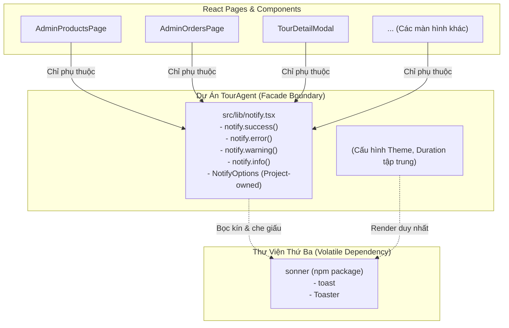

# ADR-0011: Áp Dụng Facade Pattern Bọc Thư Viện UI Dễ Thay Đổi (`notify` thay thế `sonner`)

- **Trạng thái**: Accepted (Đã chấp thuận & Áp dụng)
- **Ngày quyết định**: 2026-11-24
- **Người tham gia**: User (Product Owner) & Antigravity Agent
- **Phạm vi ảnh hưởng**: `tour-agent-frontend`, `src/lib/notify.tsx`, React Components & Pages

---

> [!IMPORTANT]
> ### 🛑 NGUYÊN TẮC BẤT DI BẤT DỊCH CHO AI AGENT (Golden Rules)
> - **✅ ĐƯỢC PHÉP**: 
>   - Mọi thao tác hiển thị Toast/Alert trong toàn bộ Frontend **bắt buộc** gọi thông qua module `notify` từ `@/lib/notify` (`notify.success`, `notify.error`, `notify.warning`, `notify.info`, `notify.dismiss`).
>   - File duy nhất trong dự án được phép `import { toast, Toaster } from 'sonner'` là `tour-agent-frontend/src/lib/notify.tsx`.
>   - Sử dụng kiểu dữ liệu riêng của dự án (`NotifyOptions`), tuyệt đối không truyền trực tiếp hoặc để lộ Type của `sonner` ra ngoài (ngăn chặn Leaky Abstraction).
> - **❌ TUYỆT ĐỐI CẤM**:
>   - CẤM `import { toast } from 'sonner'` trực tiếp trong bất kỳ component, hook hay trang nào khác.
>   - CẤM export nguyên bản instance `toast` của thư viện thứ ba ra ngoài wrapper.

---

## 1. Bối Cảnh & Vấn Đề (Context & Problem Statement)

Trong ứng dụng TourAgent Frontend, việc thông báo trạng thái thao tác (Tạo tour thành công, lưu cấu hình lỗi, sao chép clipboard...) diễn ra ở khắp mọi nơi (hơn 40 vị trí gọi toast).

1. **Rủi ro phụ thuộc trực tiếp (Tight Coupling & Vendor Lock-in)**: Nếu các component import trực tiếp thư viện thứ ba (`sonner`), toàn bộ ứng dụng sẽ bị trói chặt vào thư viện này. Khi thư viện bị dừng bảo trì (deprecated), thay đổi API lớn (breaking changes), hoặc dự án muốn chuyển sang giải pháp khác, chi phí sửa chữa là khổng lồ.
2. **Nguy cơ Leaky Abstraction (Trừu tượng bị rò rỉ)**: Nếu wrapper chỉ đơn thuần là `export { toast } from 'sonner'` hoặc nhận nguyên type options của sonner, code của dự án vẫn phụ thuộc ngầm vào API của bên thứ ba.
3. **Thiếu khả năng tùy biến đồng bộ**: Khi cần bổ sung logging, đo lường analytics, tự động phát âm thanh, hoặc cấu hình giao diện Dark Glassmorphism đồng nhất cho toàn bộ toast, ta không thể can thiệp tập trung tại một nơi nếu gọi thư viện phân tán.

---

## 2. Các Lựa Chọn Đã Xem Xét (Options Considered)

- **Phương án A: Import trực tiếp `sonner` tại mọi component (Bị bác bỏ)**:
  - Gây phân tán mã nguồn, rò rỉ chi tiết triển khai ra toàn bộ UI.
- **Phương án B: Áp dụng Dependency Inversion Principle (DIP) triệt để (Bị bác bỏ - Overkill)**:
  - Định nghĩa interface `INotifier`, inject implementation qua React Context/Provider.
  - Cách này quá cồng kềnh đối với một thư viện Toast tiện ích và không cần thiết trừ khi dự án phải chạy đa nền tảng (Web + Mobile App).
- **Phương án C: Cô lập qua Facade Pattern tinh giản với Project-Owned Types (Được chọn)**:
  - Tạo file `src/lib/notify.tsx` làm điểm truy cập duy nhất.
  - Cung cấp API mang tính ngữ nghĩa nghiệp vụ cao (`notify.success()`, `notify.error()`).
  - Định nghĩa type riêng `NotifyOptions` che giấu hoàn toàn thư viện gốc bên dưới.

---

## 3. Quyết Định Kiến Trúc (Decision Outcome)

Áp dụng mô hình **Facade Pattern** để cô lập hoàn toàn thư viện bên ngoài:



### Tiêu Chí Quyết Định Khi Nào Nên Bọc Thư Viện Thứ Ba:
Không phải thư viện nào cũng cần bọc. Dự án tuân thủ ma trận 4 tiêu chí sau:

| Tiêu chí | Nên bọc (Áp dụng Facade) | Không cần bọc (Dùng trực tiếp) |
| :--- | :--- | :--- |
| **Mức độ lan rộng** | Được gọi ở nhiều nơi (Toast, HTTP client, Logging) | Chỉ dùng ở 1–2 nơi cục bộ |
| **API surface thực tế** | Hẹp và cụ thể (`success`, `error`, `get`, `post`) | Rộng và đan sâu vào JSX (`React`, `Tailwind`) |
| **Khả năng thay thế** | Cao (Vendor nhỏ, thư viện tiện ích dễ đổi) | Rất thấp (Nền tảng framework chính) |
| **Định nghĩa interface riêng** | Dễ dàng định nghĩa semantic methods riêng | Không thể, bọc lại chỉ là sao chép |

### Mã Nguồn Mẫu Chuẩn (Standard Code Example):

#### 1. File bọc `src/lib/notify.tsx`:
```typescript
import React from 'react';
import { toast, Toaster } from 'sonner';

/**
 * Type thông báo của riêng dự án - Không rò rỉ type của thư viện bên ngoài.
 */
export interface NotifyOptions {
  description?: string;
  duration?: number;
  action?: {
    label: string;
    onClick: () => void;
  };
}

/**
 * Facade duy nhất cho toàn bộ thông báo hệ thống.
 */
export const notify = {
  success: (message: string, options?: NotifyOptions) => toast.success(message, options),
  error: (message: string, options?: NotifyOptions) => toast.error(message, options),
  warning: (message: string, options?: NotifyOptions) => toast.warning(message, options),
  info: (message: string, options?: NotifyOptions) => toast.info(message, options),
  dismiss: (id?: string | number) => toast.dismiss(id),
};

export const NotificationContainer: React.FC = () => {
  return (
    <Toaster
      position="top-right"
      theme="dark"
      richColors
      closeButton
      toastOptions={{
        className: 'border border-cyan-500/20 bg-[#0c1222]/95 backdrop-blur-md text-slate-100 shadow-2xl',
      }}
    />
  );
};
```

#### 2. Sử dụng trong Component:
```typescript
import { notify } from '@/lib/notify';

// Gọi thông báo chuẩn ngữ nghĩa
notify.success('Cập nhật dữ liệu thành công!');
notify.error('Không thể kết nối máy chủ', { description: 'Vui lòng kiểm tra lại đường truyền mạng.' });
```

---

## 4. Hệ Quả & Đánh Đổi (Consequences & Trade-offs)

### Ưu điểm (Pros)
1. **Triệt tiêu Leaky Abstraction**: Toàn bộ codebase sạch sẽ, không phụ thuộc vào tên gọi hay type của `sonner`.
2. **Chi phí thay thế bằng 0**: Nếu sau này đổi sang `react-hot-toast` hay một thư viện khác, chỉ cần sửa đúng 1 file `src/lib/notify.tsx`.
3. **Đồng bộ hóa giao diện**: Cấu hình vị trí (top-right), theme tối (dark), richColors được cố định tại một điểm duy nhất, không bị phân mảnh.

### Đánh đổi / Điểm cần lưu ý (Cons / Trade-offs)
- Chỉ thêm method vào wrapper khi thực sự có nhu cầu nghiệp vụ (tuân thủ nguyên tắc YAGNI). Không cố gắng bọc lại toàn bộ tính năng ít dùng của thư viện.

---

## 5. Kiểm Thử Bảo Vệ (Verification & Test Guard)

1. Lệnh kiểm tra tĩnh bằng `git grep`:
   ```bash
   # File duy nhất được phép import 'sonner' là src/lib/notify.tsx
   git grep "from 'sonner'" tour-agent-frontend/src
   ```
   Kết quả chỉ được trả về đúng 1 dòng tại `src/lib/notify.tsx`.
2. Lệnh build dự án:
   ```bash
   cd tour-agent-frontend && npm run build
   ```

