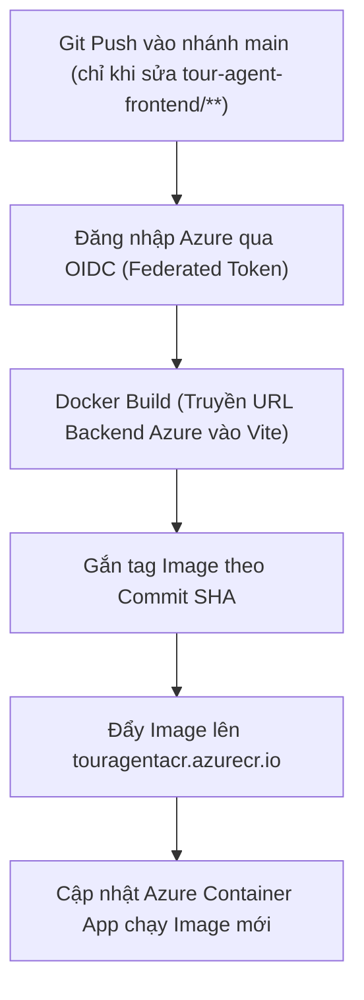

Dưới đây là bức tranh toàn cảnh và **4 bước cụ thể từ A đến Z** để bạn dễ dàng hình dung quy trình đưa frontend lên Azure Container Apps bằng giải pháp **Docker + Nginx**.

---

### 🗺️ Bức Tranh Kiến Trúc Tổng Thể

```mermaid
flowchart LR
    subgraph Local_Source ["1. Mã Nguồn"]
        React["React 19 (Vite)"]
        NginxConf["nginx.conf (try_files)"]
        Docker["Dockerfile Multi-stage"]
    end

    subgraph GitHub ["2. CI/CD Pipeline"]
        Actions["GitHub Actions (frontend-cd.yml)"]
    end

    subgraph Azure_SoutheastAsia ["3. Hạ Tầng Azure (rg-touragent-prod)"]
        ACR["Azure Container Registry (touragentacr)"]
        ACA_FE["Container App: touragent-frontend (Port 80)"]
        ACA_BE["Container App: touragent-api (Port 8080)"]
    end

    Local_Source -->|git push| Actions
    Actions -->|Build & Push Image| ACR
    ACR -->|Pull Image| ACA_FE
    ACA_FE -->|Gọi API qua HTTPS| ACA_BE
```

---

### 📋 4 Bước Cần Thực Hiện

#### BƯỚC 1: Chuẩn bị Source Code (Codebase & Docker)

Tại thư mục `tour-agent-frontend/`, chúng ta sẽ chuẩn bị 3 file:

1. **`nginx.conf`**: Cấu hình web server Nginx siêu nhẹ:
   * Mở cổng `80`.
   * Cấu hình dòng ma thuật: `try_files $uri $uri/ /index.html;` *(Đảm bảo khi người dùng F5 ở `/admin/offers` thì Nginx tự trả về `index.html` chứ không 404)*.
   * Bật nén Gzip và bật cache trình duyệt cho thư mục tĩnh `/assets/` (giúp load trang nhanh hơn Vercel).
2. **`Dockerfile` (Multi-stage build tối ưu kích thước)**:
   * **Stage 1 (Build)**: Dùng `node:20-alpine` ➔ nhận tham số URL API (`VITE_API_BASE_URL`) ➔ chạy `npm run build` ra thư mục `dist/`.
   * **Stage 2 (Runtime)**: Dùng `nginx:alpine` (dung lượng container chỉ ~25MB) ➔ chép `dist/` và `nginx.conf` vào Nginx.
3. **`.dockerignore`**: Loại bỏ `node_modules`, `.git` để quá trình đóng gói image diễn ra trong vài giây.

---

#### BƯỚC 2: Chuẩn bị Hạ tầng Cloud (Azure Container Apps)

Tin rất vui là hệ sinh thái Cloud của chúng ta ở cụm `southeastasia` **đã có sẵn**:

* Resource Group: `rg-touragent-prod`
* Container Registry: `touragentacr`
* Môi trường: `cae-touragent-prod`
* Định danh GitHub: `id-github-touragent-deploy`

👉 Chúng ta **không cần tạo mới tài nguyên tốn kém**, mà chỉ cần:

1. Tạo thêm **1 Container App mới** trong cùng môi trường `cae-touragent-prod`:
   * Tên: `touragent-frontend` (hoặc `touragent-web`).
   * Cổng đích (Target Port): `80`.
   * Ingress: `External` (cho phép người dùng toàn cầu truy cập).
2. Gán quyền Managed Identity để `touragent-frontend` tự động kéo image từ `touragentacr` mà không cần lộ mật khẩu.

---

#### BƯỚC 3: Thiết lập Pipeline CI/CD Tự Động (GitHub Actions)

Tạo file pipeline `.github/workflows/frontend-cd.yml`:

* **Ưu điểm**: Hoàn toàn tự động, mỗi khi bạn commit code frontend, GitHub sẽ tự build và deploy lên Azure Container Apps trong vòng 1–2 phút.

---

#### BƯỚC 4: Hoàn Thiện & Kiểm Thử Toàn Diện

1. **Lấy domain Azure của frontend**: (Dạng `https://touragent-frontend.<random-id>.southeastasia.azurecontainerapps.io`).
2. **Cập nhật CORS cho Backend**:
   * Thêm domain frontend mới vào biến môi trường `CORS_ALLOWED_ORIGINS` của container `touragent-api` trên Azure.
3. **Nghiệm thu**:
   * Vào trang chủ xem danh sách tour.
   * Vào thẳng trang con `/admin/offers`, `/admin/products` và nhấn **F5 nhiều lần** ➔ Nginx trả về trang mượt mà không có bất kỳ lỗi 404 nào!

---

### 💡 So Sánh: Sau khi chuyển sang Giải pháp 1 bạn được gì?

1. **Hoàn toàn độc lập**: Image Docker này bạn mang lên Azure, AWS, GCP hay kéo về máy local chạy bằng lệnh `docker run` đều hoạt động 100% giống hệt nhau.
2. **Tập trung hóa**: Cả Backend (.NET) và Frontend (React) cùng nằm chung trong cụm hạ tầng `rg-touragent-prod` tại `southeastasia`, cùng một mạng Azure Container Apps Environment.
3. **Loại bỏ hoàn toàn Vercel**: Không còn phụ thuộc vào `vercel.json` hay nền tảng thứ 3.

Nếu bạn đã hình dung rõ ràng và sẵn sàng, tôi sẽ bắt đầu ngay từ **Bước 1 (tạo `nginx.conf`, `Dockerfile` và test build image)** cho bạn!
