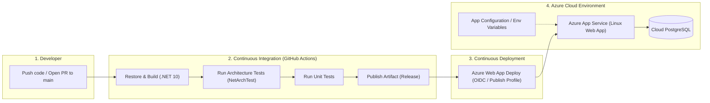

# Kế Hoạch Triển Khai CI/CD Lên Azure (Nguyên Lý 80/20 - Phiên Bản MVP Cho Phỏng Vấn)

## 1. Goal Description (Mục tiêu tổng quan)

Mục tiêu của kế hoạch này là giúp bạn:
1. **Nắm vững bản chất CI/CD**: Hiểu rõ chu trình tự động hóa từ khi code được đẩy lên Git cho đến khi chạy trên hạ tầng đám mây (Cloud - Azure).
2. **Áp dụng nguyên lý 80/20 (Pareto)**: Chỉ tập trung vào 20% khối lượng công việc cốt lõi nhưng mang lại 80% kết quả và giá trị thực tế khi đi phỏng vấn, loại bỏ các cấu hình rườm rà (như Kubernetes phức tạp, Terraform IaC nâng cao, multi-region cluster).
3. **Sở hữu phiên bản MVP thực chiến**: Triển khai backend `TourAgent.Api` (.NET 10) lên **Azure App Service (Linux)** thông qua **GitHub Actions** (hoặc Azure DevOps Pipelines), có chạy test tự động (`NetArchTest` + Unit Tests) trước khi deploy.
4. **Vũ khí phỏng vấn**: Tự tin trả lời các câu hỏi kinh điển về CI/CD, Secrets Management, Database Migration, Zero-downtime, và Deployment Strategies.

---

## 2. Phân Tích 80/20: Bỏ Gì Và Giữ Gì?

Trong các hệ sinh thái doanh nghiệp lớn, CI/CD có thể bao gồm hàng chục công cụ: SonarQube, Snyk, Terraform/Bicep, Kubernetes (AKS), Key Vault HSM, Blue/Green multi-region, Grafana/Prometheus. 

Nếu học hết tất cả những thứ trên, bạn sẽ tốn 80% thời gian nhưng khi phỏng vấn vị trí Backend Developer, người phỏng vấn chủ yếu kiểm tra **tư duy cốt lõi** và **kinh nghiệm thực tế xử lý sự cố**.

| Hạng mục | 80% Phức tạp (Lược bỏ cho MVP) | 20% Cốt lõi (Bắt buộc giữ cho MVP & Phỏng vấn) |
| :--- | :--- | :--- |
| **Hạ tầng (Hosting)** | Kubernetes (AKS), Container Apps Cluster, Multi-region | **Azure App Service (Linux)** hoặc Docker trên App Service |
| **Công cụ CI/CD** | Jenkins tự dựng, GitLab runner phức tạp | **GitHub Actions** (Industry-standard, miễn phí, dễ setup) |
| **Database** | Azure Database for PostgreSQL Flexible Server (tốn phí cao) | Dùng Azure Postgres Free tier / Supabase / Neon (Free) để tiết kiệm chi phí |
| **Secrets Management** | Azure Key Vault tích hợp Managed Identity + Private Endpoint | **GitHub Secrets** + **Azure App Service Application Settings** (Environment Variables) |
| **Kiểm thử trong CI** | E2E Tests, SonarQube Code Coverage Gate, DAST Scan | **Unit Tests + Architecture Tests (NetArchTest)** có sẵn trong repo |
| **Database Migration** | Migration Script Bundle qua Pipeline kết hợp DbUp | Tự động chạy migration lúc khởi động (`ApplyMigrations()` / `DbContext.Database.Migrate()`) hoặc CLI step |

---

## 3. Kiến Trúc Pipeline MVP (Architecture Flow)



---

## 4. Danh Sách Các Việc Cần Làm (Action Items)

Kế hoạch được chia thành 4 giai đoạn tinh gọn:

### Giai đoạn 1: Chuẩn Bị Hạ Tầng Azure (Tiêu chuẩn Free/Low-Cost)
1. **Tạo tài khoản Azure**: Sử dụng Azure Free Tier (\$200 credit hoặc Free Tier 12 tháng).
2. **Khởi tạo Azure App Service**:
   - Runtime: `.NET 10` (hoặc Container Linux).
   - Plan: F1 (Free) hoặc B1 (Basic - nếu cần custom domain / always on).
3. **Khởi tạo Database**:
   - Lựa chọn A (Tiết kiệm nhất): Dùng Cloud PostgreSQL miễn phí như Supabase, Neon hoặc Render (vì Azure Flexible Server Postgres không có gói hoàn toàn free vĩnh viễn).
   - Lựa chọn B: Azure Database for PostgreSQL Flexible Server (Burstable B1ms).
4. **Cấu hình App Settings trên Azure**:
   - Đưa chuỗi `ConnectionStrings__DefaultConnection` vào mục **Configuration / Environment variables** của App Service.
   - Cấu hình các biến nhạy cảm: `DeepSeek__ApiKey`, `Telegram__BotToken`.

### Giai đoạn 2: Chuẩn Bị Mã Nguồn & Database Migration
1. **Kiểm tra cơ chế Migration**:
   - Đảm bảo ứng dụng khi boot up có thể tự tạo/cập nhật schema DB (`db.Database.MigrateAsync()`) hoặc dùng file migration script.
2. **Kiểm tra Health Check Endpoint**:
   - Thêm endpoint `/health` (chuẩn ASP.NET Core Health Checks) để Azure App Service giám sát trạng thái sống/chết (Health Probes).

### Giai đoạn 3: Viết Pipeline GitHub Actions (`.github/workflows/deploy.yml`)
Pipeline gồm 2 jobs:
1. **Job `build-and-test` (CI)**:
   - `actions/checkout@v4`
   - Setup .NET 10 (`actions/setup-dotnet@v4`)
   - `dotnet restore`
   - `dotnet build --configuration Release --no-restore`
   - `dotnet test --no-build --verbosity normal` (chạy toàn bộ Unit Tests & Architecture Tests).
   - `dotnet publish -c Release -o ./publish`
   - Upload artifact.
2. **Job `deploy` (CD)**:
   - Chỉ kích hoạt khi push vào branch `main` và job `build-and-test` thành công.
   - Download artifact.
   - Dùng action chính chủ của Microsoft: `azure/webapps-deploy@v3`.
   - Xác thực an toàn thông qua **Publish Profile** hoặc **GitHub Secret** (hoặc OpenID Connect - OIDC Azure Federated Credentials).

### Giai đoạn 4: Kiểm Thử & Tinh Chỉnh
1. Thực hiện push commit thử nghiệm lên GitHub.
2. Quan sát từng step trong tab **Actions** trên GitHub.
3. Kiểm tra logs runtime của App Service qua **Log Stream** trên Azure Portal.
4. Gọi thử API Swagger hoặc health endpoint trên domain `.azurewebsites.net`.

---

## 5. User Review Required (Quyết định kỹ thuật cần bạn xác nhận)

> [!IMPORTANT]
> **1. Bạn muốn dùng GitHub Actions hay Azure DevOps Pipelines?**
> - **Khuyến nghị**: Dùng **GitHub Actions** vì dự án của bạn đang nằm trên GitHub, setup nhanh, tích hợp sẵn, phổ biến 90% ở các dự án open-source và công ty vừa/lớn.
> - **Lựa chọn khác**: Azure DevOps (thường gặp trong các công ty chuyên Microsoft enterprise stack).

> [!IMPORTANT]
> **2. Cơ chế Database PostgreSQL trên Cloud:**
> - Bạn đã có sẵn Azure Subscription chưa? 
> - Bạn muốn dùng Azure Database for PostgreSQL (tốn credit) hay dùng kết nối tới database Cloud miễn phí (như Neon / Supabase PostgreSQL) để tiết kiệm chi phí học tập?

> [!WARNING]
> **3. Phương thức đóng gói:**
> - **Cách 1 (Zip Deploy trực tiếp)**: Đơn giản nhất, build ra file DLL/binary rồi nén deploy thẳng lên Azure App Service Linux. Nhanh và đúng chuẩn 80/20.
> - **Cách 2 (Docker Container)**: Viết `Dockerfile`, build image, push lên Docker Hub hoặc Azure Container Registry (ACR), rồi App Service kéo về chạy. Cách này chuẩn Cloud-native hơn nhưng cần thêm bước quản lý image registry.

---

## 6. Bộ Câu Hỏi Phỏng Vấn "Ăn Điểm" Về CI/CD Cần Nắm

Khi đưa dự án này vào CV và đi phỏng vấn, các interviewer thường sẽ hỏi 5 câu cốt lõi sau. Nắm chắc 5 câu này là đạt 80% điểm phỏng vấn CI/CD:

### Câu 1: Em hãy mô tả luồng CI/CD mà em đã thiết lập cho dự án TourAgent?
- **Cách trả lời ăn điểm**:
  > *"Em thiết lập workflow bằng GitHub Actions chia làm 2 giai đoạn: CI (Continuous Integration) và CD (Continuous Deployment).*
  > *Khi tạo Pull Request vào `main`, CI sẽ tự động restore, build và chạy toàn bộ Unit Tests cùng Architecture Tests (`NetArchTest`). Điểm đặc biệt là Architecture Test đảm bảo không có ai vi phạm Clean Architecture (ví dụ: Domain không tham chiếu tầng ngoài) trước khi merge.*
  > *Khi code được merge vào `main`, CD được kích hoạt: ứng dụng được publish dưới dạng Release package và deploy tự động lên Azure App Service Linux qua Azure WebApp Deploy Action."*

### Câu 2: Em quản lý Connection String và API Key (DeepSeek, Telegram) như thế nào để không bị lộ bí mật?
- **Cách trả lời ăn điểm**:
  > *"Tuyệt đối không commit credentials vào Git. Ở môi trường local dùng `appsettings.Development.json` (được đưa vào `.gitignore`) hoặc `User Secrets`.*
  > *Trên CI/CD: Sử dụng GitHub Secrets để lưu thông tin xác thực deploy (Publish Profile/Service Principal).*
  > *Trên Cloud: Cấu hình trực tiếp vào **Environment Variables (App Settings)** của Azure App Service. ASP.NET Core hỗ trợ quy tắc `__` để map vào file config (ví dụ `ConnectionStrings__DefaultConnection`). Ở cấp độ production lớn hơn, em sẽ dùng **Azure Key Vault** kết hợp **Managed Identity** để app tự lấy secret mà không cần connection string dạng plain-text."*

### Câu 3: Làm sao để xử lý Database Migration khi triển khai tự động lên Azure?
- **Cách trả lời ăn điểm**:
  > *"Có 2 cách tiếp cận chính:*
  > *1. **Tự động apply khi ứng dụng khởi động** (`db.Database.MigrateAsync()`): Phù hợp cho MVP/dự án nhỏ, chạy đơn giản nhưng có rủi ro nếu hệ thống scale nhiều instance (gây race-condition).*
  > *2. **EF Core Migration Bundles / Script trong CI/CD pipeline**: Tạo ra file script `.sql` hoặc file binary bundle thực thi migration trước khi deploy app mới. Nếu migration lỗi, pipeline sẽ dừng lại ngay, bảo vệ hệ thống không bị lỗi runtime."*

### Câu 4: Làm thế nào để đạt Zero-Downtime Deployment trên Azure App Service?
- **Cách trả lời ăn điểm**:
  > *"Trên Azure App Service (từ tier Standard trở lên), ta sử dụng tính năng **Deployment Slots** (ví dụ slot `staging` và slot `production`).*
  > *Pipeline sẽ deploy bản mới vào slot `staging`. Khi staging khởi động xong và vượt qua các bài kiểm tra Health Check (Warm-up), hệ thống sẽ thực hiện **Slot Swap** để đổi staging thành production ngay lập tức mà người dùng không gặp downtime."*

### Câu 5: Nếu sau khi deploy phiên bản mới phát sinh lỗi nghiêm trọng, em rollback thế nào?
- **Cách trả lời ăn điểm**:
  > *"Nếu dùng Deployment Slots, em chỉ cần thực hiện **Swap ngược lại** về slot trước đó, mất dưới 1 phút.*
  > *Nếu dùng GitHub Actions không có slot, có thể cấu hình pipeline rollback bằng cách re-run workflow của commit stable trước đó, hoặc revert commit trên Git để trigger pipeline deploy lại bản cũ."*

---

## 7. Verification Plan (Kế hoạch kiểm tra sau khi dựng xong)

### Automated Tests (Kiểm tra tự động trên CI)
```powershell
# Chạy toàn bộ test cục bộ để chắc chắn pass trước khi cấu hình CI
dotnet test ./dotnet-backend-core-main/TourAgent.slnx --configuration Release
```

### Manual Verification (Kiểm tra thực tế)
1. Tạo branch mới `feature/ci-cd-test`, chỉnh sửa nhỏ và tạo PR -> Quan sát CI chạy tự động và hiển thị dấu tích xanh.
2. Merge PR vào `main` -> Quan sát CD kích hoạt và deploy lên Azure.
3. Truy cập URL: `https://<ten-app>.azurewebsites.net/api/v1/health` hoặc Swagger UI để kiểm tra API hoạt động sống.
4. Test gọi thử endpoint tạo đơn hoặc chat bot để đảm bảo DB và các service bên ngoài kết nối ổn định.
