# 🗄️ DATABASE_SCHEMA.md — Kiến Trúc Cơ Sở Dữ Liệu & Từ Điển Thực Thể

> **Hệ Quản Trị Cơ Sở Dữ Liệu:** **PostgreSQL 16** (`agent_chat_support`).
> **Mục đích tài liệu:** Cung cấp nguồn chân lý duy nhất (Single Source of Truth) về cấu trúc dữ liệu, mối quan hệ giữa các bảng, ý nghĩa từng trường, và luồng vận hành thực tế. Hệ thống đã thống nhất hoàn toàn trên PostgreSQL 16 (loại bỏ hoàn toàn sự phân mảnh SQLite; SQLite chỉ dùng cho isolated in-memory unit tests).

---

## 🏗️ 1. Bức Tranh Toàn Cảnh: 4 Miền Dữ Liệu Cốt Lõi (Core Domains)

Hệ thống được thiết kế phân tầng rõ ràng thành **4 Miền Dữ Liệu** chính:

```
┌────────────────────────────────────────────────────────────────────────┐
│ 1. PRODUCT CATALOG (Danh Mục Tour Gốc)                                 │
│    travels (Tour mẫu, lịch trình, chính sách)                          │
│       │                                                                │
│       ├── 1:N ──► travel_departures (Ngày bay cụ thể, giá người lớn/trẻ em)
│       ├── 1:N ──► travel_reviews (Đánh giá thực tế từ khách hàng)      │
│       └── 1:N ──► travel_faqs (Bộ câu hỏi FAQ tour-specific)           │
└──────────────────┬─────────────────────────────────────────────────────┘
                   │ 1:N (1 Tour gốc đóng gói thành nhiều Offer)
┌──────────────────▼─────────────────────────────────────────────────────┐
│ 2. COMMERCIAL OFFERS (Gói Ưu Đãi Thương Mại - Alex Hormozi $100M)     │
│    offers (Đóng gói giá trị, cọc 30%, giới hạn slot khan hiếm)         │
│       │                                                                │
│       └── 1:N ──► offer_items (Bảng xếp chồng giá trị: quà tặng, bonus)│
└────────────────────────────────────────────────────────────────────────┘

┌────────────────────────────────────────────────────────────────────────┐
│ 3. AI AGENT RUNTIME & OBSERVABILITY (Hội Thoại & Giám Sát AI)          │
│    conversations (Phiên chat của khách theo kênh Web/Telegram/Zalo)    │
│       │                                                                │
│       ├── 1:N ──► messages (Bộ nhớ lịch sử từng câu chat & kết quả Tool)│
│       └── 1:N ──► llm_calls (Giám sát token, latency, chi phí USD)     │
│                                                                        │
│    agent_audit_logs (Nhật ký hành động của Admin Commander)           │
└────────────────────────────────────────────────────────────────────────┘

┌────────────────────────────────────────────────────────────────────────┐
│ 4. HUMAN ESCALATION & DEAL NEGOTIATION DESK (Bàn Quyết Định Sale)      │
│    agent_escalations (Yêu cầu tư vấn gọi điện, đàm phán giảm giá)      │
│       ├── Liên kết N:1 với conversations (Smart Phone Merge chống trùng)│
│       └── Liên kết N:1 với travels (Tour khách chốt deal)              │
│       Trạng thái: pending ➔ contacting ➔ approved / rejected / closed  │
└────────────────────────────────────────────────────────────────────────┘
```

---

## 📊 2. Sơ Đồ Thực Thể Quan Hệ (Mermaid ERD)

```mermaid
erDiagram
    users ||--o{ travels : "quản lý / tạo"
    users ||--o{ offers : "tạo"
    users ||--o{ conversations : "nhân viên tiếp quản (assigned_to)"

    travels ||--|{ travel_departures : "có các ngày khởi hành"
    travels ||--o{ travel_reviews : "có đánh giá thực tế"
    travels ||--o{ travel_faqs : "có câu hỏi thường gặp"
    travels ||--o{ offers : "được đóng gói thành các gói ưu đãi"
    travels ||--o{ agent_escalations : "gắn tour khách quan tâm / deal"

    offers ||--|{ offer_items : "gồm các item giá trị & bonus"

    conversations ||--|{ messages : "chứa lịch sử tin nhắn"
    conversations ||--o{ llm_calls : "ghi nhận số lượt gọi LLM"
    conversations ||--o{ agent_escalations : "chứa các yêu cầu duyệt deal / escalate"

    crm_contacts ||--o{ conversations : "sở hữu các phiên chat"

    travels {
        bigint id PK
        bigint user_id FK
        string title "Tên tour"
        string code "Mã tour (UK)"
        string slug "Đường dẫn SEO (UK)"
        string country "Quốc gia"
        json destinations "Danh sách điểm đến"
        string departure_city "Nơi khởi hành"
        unsignedSmallInteger duration_days "Số ngày"
        unsignedSmallInteger duration_nights "Số đêm"
        string route "Lộ trình tóm tắt"
        json tags "Thẻ nhu cầu"
        decimal price_from "Giá sàn thấp nhất"
        json itinerary "Lịch trình chi tiết + ảnh"
        json inclusions "Bao gồm"
        json exclusions "Không bao gồm"
        text child_policy "Chính sách giá trẻ em"
        text payment_policy "Quy trình thanh toán"
        text cancellation_policy "Chính sách hủy & rớt visa"
        text visa_policy "Thủ tục hồ sơ visa"
        text notes "Lưu ý quan trọng"
        string status "draft/published/archived"
        boolean is_featured "Nổi bật"
    }

    travel_departures {
        bigint id PK
        bigint travel_id FK
        date departure_date "Ngày khởi hành"
        decimal price_adult "Giá người lớn"
        decimal price_child "Giá trẻ em"
        decimal single_supplement "Phụ thu phòng đơn"
        string status "open/guaranteed/full/closed"
        text notes "Ghi chú đợt bay"
    }

    travel_reviews {
        bigint id PK
        bigint travel_id FK "Liên kết tour gốc"
        string reviewer_name "Tên khách đánh giá"
        string reviewer_avatar_url "Ảnh đại diện (nullable)"
        unsignedTinyInteger rating "Đánh giá sao (1-5)"
        text content "Nội dung review thực tế"
        string travel_date "Tháng/năm khởi hành (nullable)"
        boolean is_visible "Trạng thái hiển thị"
    }

    travel_faqs {
        bigint id PK
        bigint travel_id FK "Liên kết tour gốc"
        string question "Câu hỏi thường gặp"
        text answer "Câu trả lời chi tiết"
        integer sort_order "Thứ tự sắp xếp"
        boolean is_visible "Trạng thái hiển thị"
    }

    offers {
        bigint id PK
        bigint travel_id FK "Liên kết tour gốc"
        string title "Tên gói offer"
        string slug "Slug SEO (UK)"
        string tagline "Slogan thu hút"
        string target_audience "Khách hàng mục tiêu"
        string hero_mechanism "Cơ chế độc quyền"
        decimal original_price "Tổng trị giá thực tế"
        decimal offer_price "Giá bán ưu đãi"
        unsignedSmallInteger deposit_percentage "Tỷ lệ cọc (mặc định 30%)"
        decimal deposit_amount "Số tiền cọc thực tế"
        unsignedSmallInteger max_slots_per_week "Giới hạn slot/tuần"
        unsignedSmallInteger available_slots "Số slot còn lại"
        unsignedSmallInteger urgency_hours "Thời hạn ưu đãi (giờ)"
        string status "draft/active/paused/archived"
    }

    offer_items {
        bigint id PK
        bigint offer_id FK
        string name "Tên item / quà tặng"
        string type "core / bonus"
        decimal original_value "Trị giá niêm yết"
        unsignedSmallInteger sort_order "Thứ tự sắp xếp"
        boolean is_highlighted "Đánh dấu nổi bật"
    }

    crm_contacts {
        bigint id PK
        string name "Họ tên khách"
        string phone "Số điện thoại (index)"
        string email "Email liên hệ"
        string telegram_chat_id "Telegram Chat ID (index)"
        string telegram_username "Telegram @username"
        string zalo_id "Zalo User ID"
        string channel "Kênh: telegram/web_widget/zalo"
        string stage "prospect/warm/hot/customer/lost"
        json tags "Nhãn phân loại"
        text notes "Ghi chú sở thích/nhu cầu"
        timestamp last_active_at "Tương tác cuối"
    }

    conversations {
        bigint id PK
        bigint contact_id FK "Khách hàng sở hữu"
        string channel "telegram / web_widget / zalo"
        string channel_user_id "ID định danh người chat"
        string status "bot_active / human_active / resolved"
        bigint assigned_to FK "Sales phụ trách"
        timestamp last_message_at "Thời điểm tin nhắn cuối"
        json metadata "SĐT khách, lý do escalate"
    }

    messages {
        bigint id PK
        bigint conversation_id FK
        string role "user / assistant (Kênh chat sạch, không lưu tool thô)"
        text content "Nội dung tin nhắn hiển thị"
        string channel_message_id "ID tin nhắn gốc (Chống duplicate)"
    }

    llm_calls {
        bigint id PK
        bigint conversation_id FK
        string model "deepseek-chat"
        string provider "deepseek"
        unsignedInteger prompt_tokens "Tokens đầu vào"
        unsignedInteger completion_tokens "Tokens đầu ra"
        decimal cost_usd "Chi phí ước tính USD"
        unsignedInteger latency_ms "Độ trễ phản hồi (ms)"
        json tools_called "Danh sách tên tool đã gọi"
        json tool_payloads "Telemetry: input arguments & execution results"
        text status_bar_snapshot "XML Snapshot <agent_status> tại thời điểm gọi"
        json state_snapshot "JSON Snapshot AgentStateDTO tại thời điểm gọi"
        string finish_reason "message / tool_call"
    }

    agent_escalations {
        bigint id PK
        bigint conversation_id FK
        bigint travel_id FK
        string type "deal_hot / advisor_call / escalation"
        string status "pending / contacting / approved / rejected / closed"
        string customer_name "Họ tên khách"
        string customer_phone "Số điện thoại khách (Smart Merged)"
        string chat_id "ID kênh Telegram / Zalo"
        integer discount_percent "Mức giảm đề xuất (%)"
        integer group_size "Số lượng khách"
        text notes "Tóm tắt nhu cầu, lịch sử deal"
        bigint admin_message_id "Telegram notification msg id"
        string resolved_by "Tên chuyên viên / Admin xử lý"
        timestamp resolved_at "Thời điểm giải quyết"
    }
```



---

## 📑 3. Từ Điển Dữ Liệu Chi Tiết (Data Dictionary)

---

### MIỀN 1: PRODUCT CATALOG (Danh Mục Tour Gốc)

#### 1.1 Bảng `travels` (Tour Du Lịch)
* **Ý nghĩa:** Chứa toàn bộ "Hồ sơ kỹ thuật sản phẩm gốc" mà bạn nhập bằng tay vào hệ thống. Là cơ sở để AI Agent tra cứu khi khách hàng hỏi.

| Tên Cột | Kiểu Dữ Liệu | Nullable | Mặc Định | Mô Tả & Nghiệp Vụ |
| :--- | :--- | :---: | :---: | :--- |
| `id` | BIGINT UNSIGNED | ❌ | Auto Increment | Khóa chính. |
| `user_id` | BIGINT UNSIGNED | ✅ | `NULL` | Khóa ngoại trỏ tới `users.id` (Người tạo tour). |
| `title` | VARCHAR(255) | ❌ | | Tên tour đầy đủ (Ví dụ: "Cung Đường Vàng Nhật Bản 6N5Đ..."). |
| `code` | VARCHAR(50) | ✅ | `NULL` | Mã tour duy nhất (Ví dụ: `TOUR-JP-6N5D-OSAKA-TYO`). |
| `slug` | VARCHAR(255) | ❌ | | Slug URL định danh duy nhất (tự sinh từ title, chống trùng lặp). |
| `country` | VARCHAR(100) | ✅ | `NULL` | Quốc gia (Ví dụ: "Nhật Bản", "Trung Quốc"). Phục vụ AI lọc chính xác. |
| `destinations` | JSON | ✅ | `NULL` | Mảng các địa danh tham quan: `["Osaka", "Kyoto", "Núi Phú Sĩ"]`. Lưu UTF-8 unescaped. |
| `departure_city` | VARCHAR(50) | ✅ | `NULL` | Thành phố khởi hành (Ví dụ: "TP.HCM", "Hà Nội"). |
| `duration_days` | SMALLINT UNSIGNED| ❌ | `6` | Số ngày của chuyến đi. |
| `duration_nights`| SMALLINT UNSIGNED| ❌ | `5` | Số đêm của chuyến đi. |
| `route` | VARCHAR(255) | ✅ | `NULL` | Tóm tắt lộ trình (Ví dụ: "Kansai – Osaka – Kyoto – Tokyo"). |
| `tags` | JSON | ✅ | `NULL` | Mảng thẻ phân loại nhu cầu: `["gia-dinh", "cao-cap", "kham-pha"]`. |
| `price_from` | DECIMAL(12,2) | ❌ | `0` | Giá sàn thấp nhất (Tự động cập nhật bằng `MIN(travel_departures.price_adult)`). |
| `itinerary` | JSON | ✅ | `NULL` | Mảng lịch trình chi tiết từng ngày kèm danh sách ảnh (Xem chi tiết mục 3.4). |
| `inclusions` | JSON | ✅ | `NULL` | Danh sách các dịch vụ bao gồm trong tour: `["Vé máy bay", "Khách sạn 4 sao"]`. |
| `exclusions` | JSON | ✅ | `NULL` | Danh sách các dịch vụ không bao gồm: `["Tiền tip", "Hộ chiếu"]`. |
| `child_policy` | TEXT | ✅ | `NULL` | Quy định giá vé trẻ em (Dưới 2 tuổi: 35%, Từ 2-11 tuổi: 85%...). |
| `payment_policy` | TEXT | ✅ | `NULL` | Quy trình và các đợt thanh toán cọc. |
| `cancellation_policy`| TEXT | ✅ | `NULL` | Điều kiện hủy tour và cam kết hoàn tiền rớt visa. |
| `visa_policy` | TEXT | ✅ | `NULL` | Hướng dẫn hồ sơ thủ tục xin visa du lịch. |
| `notes` | TEXT | ✅ | `NULL` | Lưu ý quan trọng về sức khỏe, hành lý, thủ tục xuất nhập cảnh. |
| `status` | VARCHAR(20) | ❌ | `'draft'` | Trạng thái tour: `draft` (Nháp), `published` (Đang mở bán), `archived` (Lưu trữ). |
| `is_featured` | BOOLEAN | ❌ | `false` | Cờ đánh dấu tour nổi bật trên trang chủ. |
| `created_at` / `updated_at` | TIMESTAMP | ✅ | | Thời gian tạo và cập nhật gần nhất. |
| `deleted_at` | TIMESTAMP | ✅ | `NULL` | Hỗ trợ Soft Delete (xóa tạm không mất dữ liệu). |

#### 1.2 Bảng `travel_departures` (Lịch Khởi Hành & Giá Theo Ngày)
* **Ý nghĩa:** Quản lý các đợt bay cụ thể của tour. Tách biệt hoàn toàn khỏi tour mẫu để giá không bị hardcode.

| Tên Cột | Kiểu Dữ Liệu | Nullable | Mặc Định | Mô Tả & Nghiệp Vụ |
| :--- | :--- | :---: | :---: | :--- |
| `id` | BIGINT UNSIGNED | ❌ | Auto Increment | Khóa chính. |
| `travel_id` | BIGINT UNSIGNED | ❌ | | Khóa ngoại trỏ tới `travels.id` (Cascade delete khi xóa tour). |
| `departure_date` | DATE | ❌ | | Ngày khởi hành (Ví dụ: `2026-10-15`). |
| `price_adult` | DECIMAL(12,2) | ❌ | | Giá tour cho 1 người lớn trong đợt này. |
| `price_child` | DECIMAL(12,2) | ✅ | `NULL` | Giá tour cho trẻ em (nếu có giá cố định). |
| `single_supplement`| DECIMAL(12,2) | ✅ | `NULL` | Phụ thu phòng đơn nếu khách đi 1 mình. |
| `status` | VARCHAR(20) | ❌ | `'open'` | Trạng thái: `open` (Còn chỗ), `guaranteed` (Chắc chắn khởi hành), `full` (Hết chỗ), `closed` (Đã đóng). |
| `notes` | TEXT | ✅ | `NULL` | Ghi chú đợt bay (Ví dụ: "Hàng không Vietnam Airlines, giờ bay đẹp"). |

---

### MIỀN 2: COMMERCIAL OFFERS (Gói Ưu Đãi Thương Mại)

#### 2.1 Bảng `offers` (Gói Ưu Đãi Bán Hàng)
* **Ý nghĩa:** Đóng gói tour gốc thành một "Grand Slam Offer" (theo công thức Alex Hormozi) để kích thích khách chốt cọc nhanh.

| Tên Cột | Kiểu Dữ Liệu | Nullable | Mặc Định | Mô Tả & Nghiệp Vụ |
| :--- | :--- | :---: | :---: | :--- |
| `id` | BIGINT UNSIGNED | ❌ | Auto Increment | Khóa chính. |
| `travel_id` | BIGINT UNSIGNED | ✅ | `NULL` | Liên kết tới tour sản phẩm gốc `travels.id`. |
| `title` | VARCHAR(255) | ❌ | | Tên gói Offer (Ví dụ: "Combo Nghỉ Dưỡng 4 Chạm Thảnh Thơi"). |
| `tagline` | VARCHAR(255) | ✅ | `NULL` | Câu slogan đánh trúng tâm lý khách hàng. |
| `target_audience` | VARCHAR(255) | ✅ | `NULL` | Chân dung khách hàng (Ví dụ: "Dân văn phòng 24-35 tuổi"). |
| `hero_mechanism` | VARCHAR(255) | ✅ | `NULL` | Cơ chế độc quyền (Ví dụ: "Công thức 4 Chạm"). |
| `original_price` | DECIMAL(12,2) | ❌ | `0` | Tổng giá trị thật sau khi cộng dồn toàn bộ Value Stack. |
| `offer_price` | DECIMAL(12,2) | ❌ | `0` | Giá bán ưu đãi đặc biệt. |
| `deposit_percentage`| SMALLINT UNSIGNED| ❌| `30` | Tỷ lệ cọc giữ chỗ (mặc định 30%). |
| `deposit_amount` | DECIMAL(12,2) | ❌ | `0` | Số tiền cọc cần thanh toán (`offer_price * deposit_percentage / 100`). |
| `max_slots_per_week`| SMALLINT UNSIGNED| ❌| `4` | Giới hạn số nhóm phục vụ tối đa mỗi tuần (Tạo sự khan hiếm). |
| `available_slots`| SMALLINT UNSIGNED| ❌ | `4` | Số slot còn trống trong tuần. |
| `urgency_hours` | SMALLINT UNSIGNED| ❌ | `24` | Thời gian đếm ngược giữ ưu đãi (giờ). |
| `status` | VARCHAR(20) | ❌ | `'draft'` | `draft`, `active`, `paused`, `archived`. |

#### 2.2 Bảng `offer_items` (Bảng Xếp Chồng Giá Trị - Value Stack)
* **Ý nghĩa:** Danh sách các dịch vụ cốt lõi và quà tặng đính kèm (Bonus) để khiến Offer trở nên "không thể từ chối".

| Tên Cột | Kiểu Dữ Liệu | Nullable | Mặc Định | Mô Tả & Nghiệp Vụ |
| :--- | :--- | :---: | :---: | :--- |
| `id` | BIGINT UNSIGNED | ❌ | Auto Increment | Khóa chính. |
| `offer_id` | BIGINT UNSIGNED | ❌ | | Khóa ngoại trỏ tới `offers.id`. |
| `name` | VARCHAR(255) | ❌ | | Tên hạng mục (Ví dụ: "Vé máy bay khứ hồi", "Voucher cafe 300k"). |
| `type` | VARCHAR(20) | ❌ | `'core'` | Loại item: `core` (Dịch vụ cốt lõi) hoặc `bonus` (Quà tặng kèm). |
| `original_value` | DECIMAL(12,2) | ❌ | `0` | Trị giá niêm yết của từng item. |
| `is_highlighted` | BOOLEAN | ❌ | `false` | Cờ tô sáng item trên giao diện landing page. |

---

### MIỀN 3: AI AGENT RUNTIME & OBSERVABILITY (Hội Thoại & Giám Sát AI)

#### 3.1 Bảng `conversations` (Phiên Hội Thoại Của Khách)
* **Ý nghĩa:** Quản lý một chuỗi trao đổi (Thread) giữa 1 khách hàng cụ thể và AI Agent trên 1 kênh giao tiếp.

| Tên Cột | Kiểu Dữ Liệu | Nullable | Mặc Định | Mô Tả & Nghiệp Vụ |
| :--- | :--- | :---: | :---: | :--- |
| `id` | BIGINT UNSIGNED | ❌ | Auto Increment | Khóa chính của phiên hội thoại. |
| `channel` | VARCHAR(20) | ❌ | | Kênh giao tiếp: `'telegram'`, `'web_widget'`, `'facebook'`. |
| `channel_user_id` | VARCHAR(100) | ❌ | | ID của khách trên kênh đó (Ví dụ Telegram chat_id `987654321` hoặc cookie web `web_abc123`). |
| `status` | VARCHAR(20) | ❌ | `'bot_active'`| Trạng thái điều hành: <br>• `bot_active`: AI đang tự động trả lời 24/7.<br>• `human_active`: Đã chuyển giao cho nhân viên Sales tiếp quản.<br>• `resolved`: Đã chốt đơn / hoàn tất tư vấn. |
| `assigned_to` | BIGINT UNSIGNED | ✅ | `NULL` | Khóa ngoại trỏ tới `users.id` (Nhân viên Sales được phân công). |
| `last_message_at`| TIMESTAMP | ✅ | `NULL` | Thời điểm tin nhắn cuối cùng được gửi. |
| `metadata` | JSON | ✅ | `NULL` | Lưu thông tin thu thập được: SĐT khách, Zalo, tóm tắt nhu cầu, lý do escalate. |

> 🔑 **Ràng buộc duy nhất:** `UNIQUE(channel, channel_user_id)` ➔ Đảm bảo 1 khách hàng trên 1 kênh luôn gắn chặt với đúng 1 phiên hội thoại duy nhất.

#### 3.2 Bảng `messages` (Lịch Sử Từng Câu Chat - Kênh Chat Sạch)
* **Ý nghĩa:** Lưu trữ lịch sử đàm thoại trực tiếp giữa Khách Hàng và AI theo lượt (`user`, `assistant`).
* **Quy tắc Kiến Trúc:** **Tuyệt đối không lưu các kết quả thực thi tool thô (`role = tool`) vào bảng `messages`**. Điều này giúp giao diện Chat (Zalo, Web, Telegram) luôn sạch sẽ, tải nhanh, không chứa chuỗi JSON rác và ngăn ngừa phình to cơ sở dữ liệu. Toàn bộ telemetry, arguments và kết quả tool được chuyển giao cho bảng `llm_calls`.

| Tên Cột | Kiểu Dữ Liệu | Nullable | Mặc Định | Mô Tả & Nghiệp Vụ |
| :--- | :--- | :---: | :---: | :--- |
| `id` | BIGINT UNSIGNED | ❌ | Auto Increment | Khóa chính. |
| `conversation_id` | BIGINT UNSIGNED | ❌ | | Khóa ngoại trỏ tới `conversations.id` (Cascade delete). |
| `role` | VARCHAR(20) | ❌ | | Vai trò người gửi: `'user'` (khách), `'assistant'` (AI consultant), `'system'`. |
| `content` | TEXT | ✅ | `NULL` | Nội dung tin nhắn văn bản hội thoại hiển thị trên UI. |
| `tool_name` | VARCHAR(100) | ✅ | `NULL` | Tên tool (chỉ dùng nếu có trường hợp đặc biệt). |
| `tool_payload` | JSON | ✅ | `NULL` | Metadata bổ trợ. |
| `channel_message_id`| VARCHAR(100) | ✅ | `NULL` | **Khóa chống lặp (Idempotency):** ID tin nhắn từ kênh gốc (Ví dụ: `tg_987654321_1024`). Nếu mạng Telegram/Zalo gửi lại retry, hệ thống nhận diện đã xử lý và bỏ qua ngay lập tức. |
| `created_at` | TIMESTAMP | ✅ | | Thời gian gửi tin. |

#### 3.3 Bảng `llm_calls` (Giám Sát Observability, Telemetry & Time-Travel Snapshots)
* **Ý nghĩa:** Giám sát thời gian thực mọi yêu cầu gửi đến DeepSeek API để kiểm soát chi phí tiền bạc, phát hiện câu hỏi gây nghẽn (latency cao), lưu vết toàn bộ công cụ thực thi và chụp lại trạng thái hệ thống (Time-Travel Observability).
* **Time-Travel Snapshots:** Mỗi lượt gọi lưu đầy đủ nguyên văn XML Status Bar (`<agent_status version="X">`) và trạng thái `AgentStateDTO` tại thời điểm đó, cho phép kỹ thuật viên xem lại chính xác AI đã "nhìn thấy" trạng thái gì trong quá khứ mà không cần đoán mò.

| Tên Cột | Kiểu Dữ Liệu | Nullable | Mặc Định | Mô Tả & Nghiệp Vụ |
| :--- | :--- | :---: | :---: | :--- |
| `id` | BIGINT UNSIGNED | ❌ | Auto Increment | Khóa chính. |
| `conversation_id` | BIGINT UNSIGNED | ✅ | `NULL` | Phiên hội thoại phát sinh lượt gọi LLM này. |
| `model` | VARCHAR(50) | ❌ | | Model AI sử dụng: `'deepseek-chat'` (DeepSeek V3). |
| `provider` | VARCHAR(30) | ❌ | | Nhà cung cấp: `'deepseek'`. |
| `prompt_tokens` | UNSIGNED INT | ❌ | `0` | Số token đầu vào (System prompt + History + Lệnh). |
| `completion_tokens`| UNSIGNED INT | ❌ | `0` | Số token do AI sinh ra ở đầu ra. |
| `cost_usd` | DECIMAL(10,6) | ✅ | `NULL` | Chi phí tiền mặt ước tính theo USD (Giá DeepSeek: $0.14/1M in, $0.28/1M out). |
| `latency_ms` | UNSIGNED INT | ❌ | `0` | Thời gian phản hồi từ API (miligiây). |
| `tools_called` | JSON | ✅ | `NULL` | Mảng tên các tool AI đã yêu cầu gọi trong turn này: `["search_travels"]`. |
| `tool_payloads` | JSON | ✅ | `NULL` | Mảng chi tiết arguments và output results của các tool thực thi trong lượt gọi đó. |
| `status_bar_snapshot` | TEXT | ✅ | `NULL` | Bản lưu nguyên văn XML `<agent_status version="X">` tại thời điểm gọi. |
| `state_snapshot` | JSON | ✅ | `NULL` | Bản lưu JSON của `AgentStateDTO` (version, goal, status, facts, domain_state). |
| `finish_reason` | VARCHAR(30) | ✅ | `NULL` | Lý do kết thúc: `'message'` (trả lời xong) hoặc `'tool_call'` (cần gọi tool). |

#### 3.4 Bảng `agent_audit_logs` (Nhật Ký Quản Trị Hệ Thống Của AI)
* **Ý nghĩa:** Ghi lại mọi thao tác AI tác động vào cơ sở dữ liệu (đổi giá offer, cập nhật slot, đổi trạng thái) theo lệnh của Admin.

| Tên Cột | Kiểu Dữ Liệu | Nullable | Mặc Định | Mô Tả & Nghiệp Vụ |
| :--- | :--- | :---: | :---: | :--- |
| `id` | BIGINT UNSIGNED | ❌ | Auto Increment | Khóa chính. |
| `user_id` | BIGINT UNSIGNED | ✅ | `NULL` | ID của Admin ra lệnh. |
| `channel` | VARCHAR(20) | ❌ | | `'web'`, `'telegram'`. |
| `tool_name` | VARCHAR(100) | ❌ | | Tên tool đã thực thi (Ví dụ: `update_offer_price`). |
| `user_message` | TEXT | ✅ | `NULL` | Câu lệnh gốc của Admin: "Đổi giá combo thành 3.5tr". |
| `arguments` | JSON | ❌ | | Tham số đã truyền vào tool: `{"offer_id": 1, "price": 3500000}`. |
| `result` | JSON | ❌ | | Dữ liệu trả về sau khi đổi giá. |
| `status` | VARCHAR(20) | ❌ | `'success'`| `'success'` hoặc `'failed'`. |

---

### MIỀN 4: HUMAN ESCALATION & DEAL NEGOTIATION DESK (Bàn Quyết Định Sale)

#### 4.1 Bảng `agent_escalations` (Yêu Cầu Tư Vấn & Đàm Phán Giảm Giá)
* **Ý nghĩa:** Là trung tâm điều phối của màn hình "Bàn Quyết Định" (`/admin/ai/escalations`). Khi khách hàng muốn tư vấn riêng, deal giảm giá (ví dụ 10%, 20%), hoặc để lại số điện thoại, hệ thống sẽ gom và quản lý toàn bộ yêu cầu tại đây.
* **Cơ chế Smart Phone Merge:** Nếu cùng một khách hàng trong phiên hội thoại tiếp tục gửi thêm số điện thoại hoặc thay đổi nhu cầu, hệ thống tự động cập nhật vào bản ghi đang `pending` thay vì tạo trùng lặp, giữ cho hàng đợi luôn tinh gọn và tránh spam thông báo.
* **Độc Lập Kênh & Đa Nền Tảng (Cross-Channel):** Telegram chỉ đóng vai trò kênh nhận thông báo tức thì (Notification Center). Mọi quyết định nghiệp vụ (Tiếp nhận / Đang gọi, Cập nhật ghi chú / %, Duyệt ưu đãi, Giữ giá niêm yết, Đóng vé) được thực hiện tập trung trên Web Desk để vận hành đồng nhất khi kết nối Zalo OA, Zalo cá nhân, Facebook Messenger.

| Tên Cột | Kiểu Dữ Liệu | Nullable | Mặc Định | Mô Tả & Nghiệp Vụ |
| :--- | :--- | :---: | :---: | :--- |
| `id` | BIGINT UNSIGNED | ❌ | Auto Increment | Khóa chính (Mã hiển thị vé: `#ESC-12`). |
| `conversation_id` | BIGINT UNSIGNED | ❌ | | Khóa ngoại trỏ tới `conversations.id`. |
| `travel_id` | BIGINT UNSIGNED | ✅ | `NULL` | Khóa ngoại trỏ tới `travels.id` (Tour khách quan tâm / deal giá). |
| `type` | VARCHAR(30) | ❌ | `'deal_hot'` | Phân loại: `'deal_hot'` (Xin chiết khấu), `'advisor_call'` (Yêu cầu gọi tư vấn), `'escalation'` (Chuyển tiếp hỗ trợ chung). |
| `status` | VARCHAR(30) | ❌ | `'pending'` | Trạng thái vé:<br>• `pending`: Đang chờ xử lý.<br>• `contacting`: Đang gọi tư vấn (Bắt buộc phải có SĐT).<br>• `approved`: Quản lý duyệt mức chiết khấu.<br>• `rejected`: Từ chối giảm, giữ nguyên giá tour niêm yết.<br>• `closed`: Đóng vé (Khách không bắt máy / từ chối mua). |
| `customer_name` | VARCHAR(100) | ✅ | `NULL` | Tên khách hàng do AI bóc tách từ hội thoại. |
| `customer_phone` | VARCHAR(50) | ✅ | `NULL` | Số điện thoại khách hàng (Chuẩn hóa tự động). |
| `chat_id` | VARCHAR(100) | ✅ | `NULL` | ID kênh chat (Telegram chat ID, Zalo User ID, Web Session ID). |
| `discount_percent` | INT | ✅ | `NULL` | Mức phần trăm giảm giá khách yêu cầu (Ví dụ: `10`, `12`, `20`). Chuyên viên có thể điều chỉnh theo thực tế thương lượng. |
| `group_size` | INT | ✅ | `1` | Số lượng khách đi cùng đoàn. |
| `notes` | TEXT | ✅ | `NULL` | Lịch sử tóm tắt nhu cầu, diễn biến cuộc gọi, thỏa thuận giữa khách và tư vấn viên. |
| `admin_message_id` | BIGINT | ✅ | `NULL` | Message ID thông báo trên Telegram Admin (phục vụ đối soát). |
| `resolved_by` | VARCHAR(100) | ✅ | `NULL` | Tên người xử lý (Ví dụ: `'Chuyên Viên Tư Vấn (Web Desk)'`). |
| `resolved_at` | TIMESTAMP | ✅ | `NULL` | Thời điểm hoàn tất xử lý vé. |
| `created_at` / `updated_at` | TIMESTAMP | ✅ | | Thời gian tạo và cập nhật gần nhất. |

---

## 🧩 5. Cấu Trúc Chi Tiết Các Cột Dạng JSON

### 5.1 Cột `travels.itinerary` (Lịch Trình Chi Tiết & Hình Ảnh)
Được lưu dưới dạng mảng các Object đại diện cho từng ngày:
```json
[
  {
    "day": 1,
    "title": "TP.HCM – KANSAI (Nghỉ đêm trên máy bay)",
    "content": "Sáng: Quý khách tập trung tại sân bay Tân Sơn Nhất. Trưa: Ăn nhẹ trên máy bay. Tối: Nghỉ ngơi.",
    "images": [
      "https://images.unsplash.com/photo-1542051841857-5f90071e7989",
      "https://images.unsplash.com/photo-1493976040374-85c8e12f0c0e"
    ]
  },
  {
    "day": 2,
    "title": "OSAKA – CỐ ĐÔ KYOTO – RỪNG TRÚC SAGANO",
    "content": "Sáng: Ăn buffet tại khách sạn. Tham quan Chùa Vàng Kinkakuji. Trưa: Thưởng thức bò Kobe...",
    "images": [
      "https://images.unsplash.com/photo-1492571350019-22de08371fd3"
    ]
  }
]
```

### 5.2 Cột `travels.destinations` & `travels.tags`
- `destinations`: `["Kansai", "Osaka", "Kyoto", "Núi Phú Sĩ", "Tokyo"]` *(Lưu UTF-8 unescaped để câu lệnh SQL `LIKE '%Phú Sĩ%'` tìm kiếm chính xác tiếng Việt có dấu)*.
- `tags`: `["gia-dinh", "cao-cap", "kham-pha"]`.

### 5.3 Cột `conversations.metadata`
Lưu trữ thông tin nhận diện khách hàng do AI thu thập được qua trò chuyện:
```json
{
  "escalated_at": "2026-09-02T08:30:00+07:00",
  "escalation_reason": "Khách muốn đặt cọc giữ chỗ 2 vé",
  "customer_phone": "0901234567",
  "customer_name": "Anh Nghĩa",
  "summary": "Khách quan tâm tour Nhật Bản tháng 10 cho 2 người lớn, cần phòng đôi"
}
```

---

## 🔄 6. Vòng Đời Dữ Liệu (Data Lifecycle & Flow)

Quy trình dữ liệu di chuyển trong hệ thống theo 4 bước khép kín:

```
[BƯỚC 1: NHẬP LIỆU TOUR MẪU]
Bạn nhập form trên Dashboard ➔ Lưu vào `travels` và `travel_departures`
Hệ thống tự gán `travels.price_from` = giá thấp nhất của các đợt bay.
                                    │
                                    ▼
[BƯỚC 2: ĐÓNG GÓI BÁN HÀNG (Tùy chọn)]
Tạo Offer liên kết `offers.travel_id` ➔ Bổ sung Value Stack vào `offer_items`
                                    │
                                    ▼
[BƯỚC 3: KHÁCH HÀNG HỎI AI TƯ VẤN]
Khách nhắn qua Web Chat, Telegram hoặc Zalo:
1. Hệ thống tìm/tạo `conversations`.
2. Lưu câu hỏi vào `messages` (role: user, channel_message_id).
3. `AgentLoop` tải 12 tin nhắn gần nhất làm context, build `<agent_status>` từ `StatusBarBuilder`, gọi DeepSeek V3.
4. DeepSeek gọi Tool (`search_travels`, `check_departures`, `get_travel_itinerary`, `propose_discount`, `escalate_to_human`).
5. Kết quả tool được giữ trong RAM Context và lưu telemetry vào `llm_calls.tool_payloads` cùng snapshot XML & State (tuyệt đối không lưu vào `messages` để giữ sạch UI) ➔ LLM tiếp tục suy luận & tổng hợp câu trả lời.
6. Lưu câu trả lời hoàn chỉnh vào `messages` (role: assistant) ➔ Ghi nhận chi phí token và snapshots vào `llm_calls`.
                                    │
                                    ▼
[BƯỚC 4: KHÁCH XIN GIẢM GIÁ / ĐỂ LẠI SĐT / CHỐT ĐƠN]
1. Khách deal giá (10%, 20%) hoặc yêu cầu gọi điện ➔ Kích hoạt `propose_discount` hoặc `escalate_to_human`.
2. Tạo vé mới trong `agent_escalations` (mã #ESC-xx) hoặc Smart Merge SĐT vào vé `pending` sẵn có.
3. Gửi thông báo tức thì lên Telegram Admin/Sales (kèm link mở thẳng Web Desk).
4. Chuyên viên Sale mở "Bàn Quyết Định" (`/admin/ai/escalations`):
   • Bấm [Đang gọi tư vấn] để tiếp nhận (khóa duplicate gọi đè).
   • Trong khi gọi, có thể cập nhật linh hoạt % chiết khấu nếu deal thêm (vd: từ 10% lên 12%) và lưu ghi chú.
   • Bấm [Duyệt ưu đãi] để chốt sale hoặc [Giữ giá niêm yết] / [Đóng vé] nếu không thành công.
5. Thông báo kết quả tự động gửi về kênh chat của khách hàng.
```
