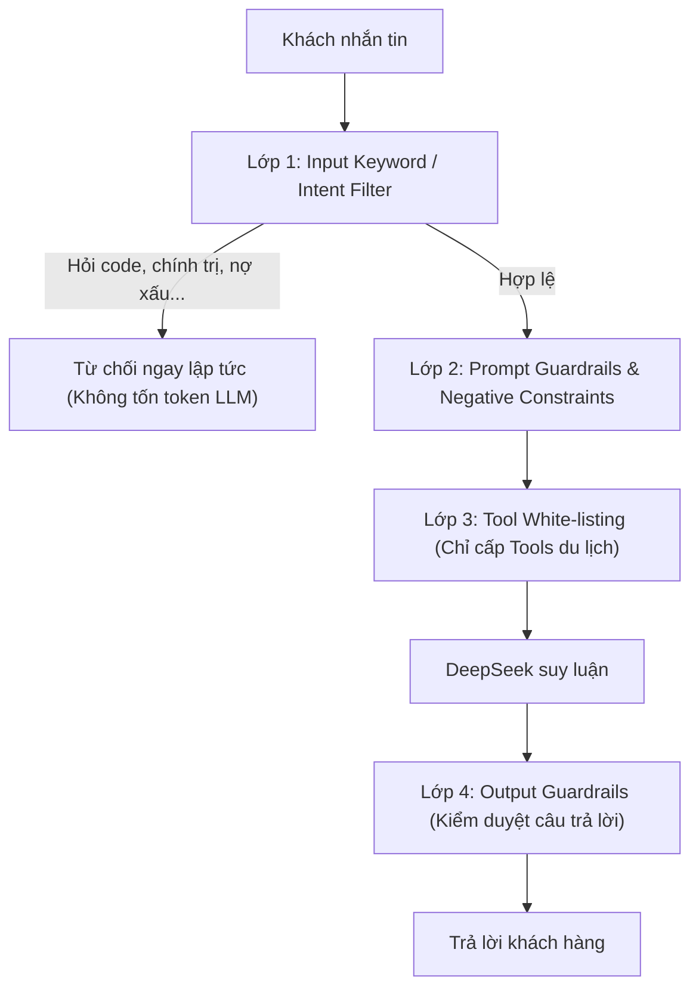

# 🤖 LESSONS_LEARNED_AGENT.md — Chuyên Đề Thiết Kế AI Agent: Rào Chắn Nghiệp Vụ (Guardrails) & Bộ Nhớ Hội Thoại (Conversation Memory)

> **Tài liệu chưng cất kiến thức chuyên sâu về Kiến trúc AI Agent trong môi trường doanh nghiệp (Production AI)**.
> Giải quyết 2 bài toán sống còn:
> 1. Cách chặn triệt để các câu hỏi ngoài nghiệp vụ (viết code, xem giờ, trò chuyện phiếm, jailbreak).
> 2. Quản trị ngữ cảnh dài hạn khi giới hạn sliding window (12 tin nhắn gần nhất) mà không làm mất thông tin quan trọng của khách hàng.

---

Đây là 2 câu hỏi cực kỳ xuất sắc, chạm đúng vào **bản chất cốt lõi của Kiến trúc AI Agent trong môi trường doanh nghiệp (Production AI)**.

---

## PHẦN 1: Tại Sao Bot Lại Từ Chối Trả Lời Code & Thời Gian?

Bạn thấy ngạc nhiên vì bình thường chat với ChatGPT/DeepSeek trên web thì hỏi gì nó cũng trả lời (kể chuyện cười, viết code, làm thơ...). Nhưng con Bot của bạn thì **từ chối thẳng thừng**:

### 🔍 Bản Chất Kỹ Thuật Đang Diễn Ra Trong Hệ Thống Của Bạn
Hệ thống hiện tại của bạn đã tự động kích hoạt **3 cơ chế phòng thủ** tự nhiên:

1. **Rào chắn Persona & Giới hạn thẩm quyền (System Prompt Boundaries):**
   Trong file [`TravelAgentPrompts.php`](file:///d:/Nghĩa/AI-Agent-Travel/kp3-backend-core-main/modules/AiAgent/Services/TravelAgentPrompts.php), ta đã định nghĩa rất đanh thép:
   > *"Bạn là Chuyên viên Tư Vấn Du Lịch AI chuyên nghiệp... Nhiệm vụ của bạn là hỗ trợ tư vấn khách hàng 24/7 về tour, lịch trình, báo giá, chính sách... Mọi thông tin cung cấp PHẢI dựa trên kết quả trả về từ CÔNG CỤ (TOOLS)."*
   Khi gặp câu hỏi về code C#, DeepSeek so khớp với nhiệm vụ được giao và thấy hoàn toàn nằm ngoài thẩm quyền được phép trả lời.
2. **Cơ chế Tool-Gating (Khoá bằng công cụ):**
   * Với câu hỏi *"hôm nay là thứ mấy?"*: Ở module Tyler Admin (`AiAgentService`), ta cấp công cụ `get_current_time`. Nhưng ở module Tư vấn khách (`AgentLoop`), ta **chỉ cấp đúng 5 công cụ du lịch** (`search_travels`, `check_departures`...). 
   * Do System Prompt cấm *"không được tự bịa đặt khi không có công cụ"*, nên khi không có công cụ xem giờ, DeepSeek thành thật trả lời: *"Em không có khả năng xem ngày giờ hiện tại thực tế ạ."*
3. **Nhiệt độ thấp (`temperature = 0.1`):**
   * Nếu để `temperature = 0.7 - 1.0`, LLM sẽ có xu hướng "nhiệt tình thái quá" và trả lời mọi thứ. Khi set `0.1`, LLM trở nên kỷ luật, nghiêm túc và tuân thủ rào chắn 100%.

---

### 🛡️ Các Cách Để "Chặn Triệt Để" Vấn Đề Ngoài Du Lịch (Trong Doanh Nghiệp)

Trong thực tế, để bảo vệ bot không bị người dùng "troll", bẻ khóa (Jailbreak) hoặc lợi dụng tài khoản API công ty để giải bài tập, viết code, các chuyên gia sử dụng **mô hình phòng thủ 4 lớp (Defense-in-Depth)**:



| Cấp độ | Tên giải pháp | Cách hoạt động | Ưu/Nhược điểm |
| :--- | :--- | :--- | :--- |
| **Cấp 1 (Đang dùng)** | **Prompt Guardrails & Low Temp** | Quy định rõ trong System Prompt: *"Chỉ trả lời trong phạm vi du lịch, từ chối lịch sự mọi chủ đề khác"*. | Dễ làm nhất, nhưng người dùng cao tay có thể dùng kỹ thuật Jailbreak để vượt qua. |
| **Cấp 2 (Đang dùng)** | **Tool-Gating** | Chỉ đưa vào những công cụ phục vụ kinh doanh du lịch. | Chặn được việc AI tự ý can thiệp hệ thống khác. |
| **Cấp 3 (Nâng cao)** | **Intent Router / Guardrail Model** | Dùng 1 model siêu nhẹ hoặc thư viện như *NeMo Guardrails* / *Llama Guard* kiểm tra trước: *"Câu này có thuộc nghiệp vụ du lịch không?"*. Nếu không ➔ Trả lời mẫu từ chối ngay mà không gửi vào DeepSeek chính. | **Tiết kiệm 100% chi phí token** khi bị spam câu hỏi linh tinh. |
| **Cấp 4 (Nâng cao)** | **Input Sanitization & Keyword Blocklist** | Chặn các từ khóa nhạy cảm, mã lệnh code (`<script>`, `SELECT *`, `exec()`) ngay tại Controller Laravel. | Chống tấn công injection. |

---

## PHẦN 2: Giới Hạn 12 Tin Nhắn & Cách Giải Quyết Khi Khách Hỏi Chuyện Cũ

> **Tình huống thực tế:**
> * Tin nhắn thứ 1: Khách nói *"Tôi tên Tuấn, đi 2 vợ chồng và bé nhỏ 3 tuổi"*.
> * Khách chat liên tục 15 tin tiếp theo hỏi về khách sạn, visa, cảnh đẹp...
> * Đến tin nhắn thứ 18: Khách hỏi *"Bé nhà tôi có được miễn phí vé không?"*.
> * **Vấn đề:** Do hệ thống chỉ lấy 12 tin gần nhất, thông tin *"bé nhỏ 3 tuổi"* đã trôi mất. Bot sẽ phải hỏi lại: *"Dạ anh/chị cho em hỏi bé nhà mình mấy tuổi ạ?"* ➔ Trải nghiệm khách hàng bị giảm sút.

Có **3 giải pháp kiến trúc** để xử lý bài toán này:

---

### 💡 Giải Pháp 1: Conversation State / Entity Memory (Khuyên dùng nhất ⭐⭐⭐⭐⭐)

Đây là cách chuẩn nhất, rẻ nhất và phù hợp 100% với kiến trúc hiện tại của dự án.

* Bảng [`conversations`](file:///d:/Nghĩa/AI-Agent-Travel/kp3-backend-core-main/modules/AiAgent/Models/Conversation.php) của chúng ta **đã có sẵn cột `metadata` (JSON)**.
* **Cơ chế:** Khi khách hàng tiết lộ thông tin cá nhân hoặc nhu cầu cốt lõi, ta trích xuất và lưu vào `conversations.metadata`:
  ```json
  {
    "customer_name": "Tuấn",
    "pax_adults": 2,
    "pax_children": 1,
    "child_age": 3,
    "target_destination": "Nhật Bản",
    "budget": "35-40tr"
  }
  ```
* **Khi gọi LLM:** Dù cuộc chat dài 100 tin nhắn và chỉ lấy 12 tin gần nhất, ta **luôn tiêm (inject) khối State này vào đầu System Prompt**:
  > *"Hồ sơ khách hàng hiện tại: Anh Tuấn, đi cùng vợ và con 3 tuổi, quan tâm tour Nhật Bản."*
* 👉 **Kết quả:** Dù tin nhắn nói về "bé 3 tuổi" đã trôi qua từ 3 ngày trước, AI vẫn luôn biết đứa bé 3 tuổi và trả lời chính xác chính sách vé trẻ em!

---

### 💡 Giải Pháp 2: Rolling Summary (Tóm Tắt Cuộc Hội Thoại Cuốn Chiếu)

* Khi số tin nhắn trong cuộc hội thoại vượt quá 12 tin:
  * Hệ thống cho 1 tiến trình nền (Job ngầm) tóm tắt các tin nhắn cũ từ 13 trở về trước thành 1 đoạn văn ngắn 2-3 câu:
    > *"Tóm tắt các trao đổi trước: Khách hàng tên Tuấn tìm hiểu tour Nhật Bản khởi hành tháng 10 cho gia đình 3 người (1 bé 3 tuổi). Đã xem qua lịch trình Osaka - Tokyo."*
* Ngữ cảnh gửi cho DeepSeek sẽ gồm:
  `System Prompt` + `Đoạn Tóm Tắt Quá Khứ` + `8-10 tin nhắn mới nhất dạng đầy đủ`.
* 👉 **Kết quả:** Vừa giữ được ngữ cảnh quá khứ xuyên suốt, vừa không làm phình to số lượng token.

---

### 💡 Giải Pháp 3: Semantic Message Retrieval (RAG Trên Lịch Sử Chat)

* Mỗi tin nhắn của khách được chuyển thành vector (Embedding).
* Khi khách hỏi một câu có tính chất gợi nhớ chuyện cũ (như *"như tôi đã nói ban đầu..."*, *"còn đứa bé thì sao?"*):
  * Hệ thống tìm kiếm các tin nhắn cũ có độ liên quan cao trong quá khứ và kéo đúng tin nhắn đó ghép vào prompt.
* *(Giải pháp này thường dùng cho các hệ thống chăm sóc khách hàng khổng lồ của ngân hàng hoặc sàn TMĐT khi khách chat hàng tháng trời).*

---

### 🎯 Tóm lại lộ trình áp dụng cho dự án của bạn:
1. Hiện tại, cơ chế **12 tin nhắn gần nhất** đang chạy rất mượt cho các cuộc tư vấn thông thường (chốt tour trong 10-15 phút).
2. Khi bước sang giai đoạn hoàn thiện booking, ta chỉ cần kích hoạt **Giải Pháp 1 (Lưu Profile vào `conversations.metadata`)**, đây là cách tối ưu nhất: vừa nhẹ, không tốn thêm tiền token, mà bot lại cực kỳ thông minh như nhân viên tư vấn có trí nhớ siêu việt!

---

## PHẦN 3: Bài Học Ngữ Cảnh Trang Đích (Landing Page / Tour Context Injection)

> **Vấn đề gặp phải (Incident):**  
> Khi khách hàng đang lướt trang tour *Cung Đường Vàng Nhật Bản 6N5Đ* và mở widget chat hỏi: *"cho tôi biết về thủ tục visa"*, AI Agent trả lời: *"Dạ em cần biết anh/chị đang quan tâm đến tour nào..."*.
> 
> **Nguyên nhân gốc rễ:**  
> Widget gửi tin nhắn lên API nhưng không truyền `travel_id`. Agent tuân thủ rào chắn chống bịa đặt (Anti-Hallucination) nên khi không biết `travel_id` của tour nào, Agent không thể gọi tool `get_travel_policies` và buộc phải hỏi lại khách.
> 
> **Giải pháp kiến trúc chuẩn đã áp dụng:**  
> 1. **Frontend:** Gửi kèm `travel_id` từ trang tour đang hiển thị.
> 2. **Backend Controller:** Lưu `travel_id`, `travel_title`, `travel_country` vào `conversations.metadata`.
> 3. **AgentLoop & Prompt Injection:** Trích xuất thông tin tour từ metadata và tiêm vào System Prompt khối chỉ dẫn `CURRENT TOUR CONTEXT`: Bắt buộc Agent mặc định tra cứu theo tour này nếu khách hỏi câu hỏi chung chung mà không nêu tên tour khác.

---

## PHẦN 4: Bài Học Giao Thức LLM Tool Calling & Lịch Sử Đa Lượt (Multi-Turn Tool Protocol Conformance)

> **Vấn đề gặp phải (Incident — 27/09/2026):**  
> Ở lượt chat thứ 1 ("mình muốn tìm tour Nhật cho 3 người"), AI Agent gọi tool `search_travels` và trả lời rất tốt.  
> Tuy nhiên, sang lượt chat thứ 2 ("ngày gần nhất là ngày mấy?"), bot Telegram hoàn toàn **im lặng không phản hồi** mặc dù Webhook vẫn nhận 200 OK.

### 🔍 Phân Tích Nguyên Nhân Gốc Rễ (Deep-Dive Root Cause):
1. **Lỗi thực tế từ DeepSeek API:**
   ```json
   {
     "error": {
       "message": "Messages with role 'tool' must be a response to a preceding message with 'tool_calls' (request_id: dedd9fb5-3904-4f38-a6a0-f3b4943acfb8)",
       "type": "invalid_request_error",
       "code": "invalid_request_error"
     }
   }
   ```
2. **Bản chất của giao thức OpenAI / DeepSeek Tool Calling:**
   - DeepSeek/OpenAI quy định rằng mọi tin nhắn có role: 'tool' bắt buộc phải là phản hồi nối tiếp ngay sau một tin nhắn assistant chứa tool_calls. Trước đó, khi nạp lại pastMessages từ CSDL, mảng messages chứa các tin nhắn Tool trần trụi mà không có tin nhắn Assistant chứa tool_calls đứng trước nó, dẫn đến lỗi 400 Bad Request làm gián đoạn phản hồi của bot
   - Trong một lượt suy luận nội bộ (Intra-turn Execution), chuỗi tin nhắn bắt buộc phải theo cặp:
     `assistant (có tool_calls)` ➔ `tool (kết quả tool với đúng tool_call_id)` ➔ `assistant (câu trả lời tổng hợp)`.
   - Trong bảng CSDL `messages`, hệ thống lưu tuần tự:
     `Message 1: User` ➔ `Message 2: Tool` ➔ `Message 3: Assistant`. (Không lưu tin nhắn trợ lý trung gian chứa `tool_calls`).
   - Đến lượt chat thứ 2, khi hàm `AgentLoop.cs` nạp lại `pastMessages` từ CSDL và đưa tin nhắn `Role == Tool` vào mảng `messages`, DeepSeek API phát hiện một tin nhắn `tool` trần trụi (orphan tool message) mà không có tin nhắn `assistant` (chứa `tool_calls`) đứng ngay trước nó.
   - DeepSeek API lập tức từ chối với lỗi **400 Bad Request**, khiến luồng worker ngắt ngang và không trả lời khách hàng.

### 🛡️ Giải Pháp Kiến Trúc Chuẩn (Best Practice):
- **Phân tách rạch ròi giữa Lịch Sử Đối Thoại (Conversation History) và Nhật Ký Thực Thi (Execution Audit):**
  - **Lịch Sử Đối Thoại gửi cho LLM:** Chỉ gồm chuỗi trao đổi thực sự giữa con người và AI: `User` ➔ `Assistant` ➔ `User` ➔ `Assistant`.
  - **Nhật Ký Thực Thi (Tool Messages):** Chỉ phục vụ suy luận nội bộ trong chính lượt đó và lưu vào CSDL để phục vụ kiểm toán / thanh tra trên màn hình `/admin/conversations`.
- Trong `AgentLoop.cs`, nạp `pastMessages` với bộ lọc nghiêm ngặt:
  ```csharp
  var pastMessages = conversation.Messages
      .Where(m => (m.Role == MessageRole.User || m.Role == MessageRole.Assistant) && !string.IsNullOrWhiteSpace(m.Content))
      .OrderBy(m => m.CreatedAtUtc)
      .TakeLast(12)
      .ToList();
  ```
  *(Giải pháp này hoàn toàn đồng nhất với mã nguồn chuẩn của Laravel core: `whereIn('role', ['user', 'assistant'])`).*

