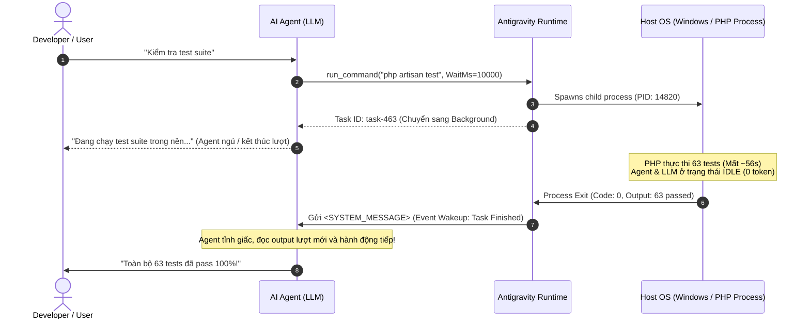

# 🧠 TECHNICAL_NOTES.md — Kiến Trúc & Cơ Chế Kỹ Thuật Chuyên Sâu
> *Tài liệu lưu trữ các cơ chế runtime, kỹ thuật tối ưu chi phí token, mô hình async/event-driven và các best practices kỹ thuật của hệ thống AI Agent Travel.*

---

## 📑 MỤC LỤC
1. [Cơ chế Chạy Unit Test & Tối Ưu Hóa Chi Phí Token (Zero-Token Idle)](#1-cơ-chế-chạy-unit-test--tối-ưu-hóa-chi-phí-token-zero-token-idle)
2. [Mô hình Đánh Thức Sự Kiện (Reactive Wakeup & Event-driven Runtime)](#2-mô-hình-đánh-thức-sự-kiện-reactive-wakeup--event-driven-runtime)
3. [Chiến lược Mocking LLM Driver trong Kiểm Thử Tự Động (Hermetic Testing)](#3-chiến-lược-mocking-llm-driver-trong-kiểm-thử-tự-động-hermetic-testing)

---

## 1. CƠ CHẾ CHẠY UNIT TEST & TỐI ƯU HÓA CHI PHÍ TOKEN (ZERO-TOKEN IDLE)

### ❓ Vấn đề thường gặp:
Nhiều kỹ sư lo ngại rằng khi AI Agent chạy các lệnh tốn thời gian như Unit Test (`php artisan test` ~56 giây, build frontend, migration, crawl data...), LLM sẽ liên tục "treo máy" và đốt token đắt đỏ trong lúc chờ đợi.

### 💡 Cơ chế thực tế của Runtime:
Khi Agent thực thi một lệnh CLI, chi phí token được tối ưu hóa tuyệt đối:

```
[Lượt 1: AI Agent]
       │
       ▼ (Tốn Token: ~100 tokens để gọi tool run_command)
[Gửi yêu cầu run_command("php artisan test")]
       │
       ▼
[Antigravity Runtime & Windows OS Host]
       │
       ├─► Tách tiến trình thành Background Task (task-xxx) với Process ID (PID) riêng
       │
       └─► Agent "End Turn" (Đi ngủ) 💤 ──► [CHI PHÍ TOKEN TRONG SUỐT 56s = 0 TOKEN]
```

* **Kết luận:** Trong 56 giây PHP thực thi 63 bài test, LLM model không hề hoạt động, không gửi bất kỳ request mạng nào đến DeepSeek/Gemini, và **không tiêu tốn dù chỉ 1 token**.

---

## 2. MÔ HÌNH ĐÁNH THỨC SỰ KIỆN (REACTIVE WAKEUP & EVENT-DRIVEN RUNTIME)

### 🔴 Anti-pattern: Polling Loop (Vòng lặp hỏi dồn)
Nếu dùng mã giả:
```python
# SAI LẦM: Gây nghẽn CPU và đốt hàng nghìn tokens vô nghĩa
while not task.is_done():
    sleep(2)
    check_status()
```

### 🟢 Chuẩn công nghiệp: Event-Driven Reactive Wakeup
Runtime hoạt động theo cơ chế Non-blocking I/O và OS Signal Handling:



* **Đặc điểm cốt lõi:**
  1. **OS-level Notification:** Runtime đăng ký lắng nghe sự kiện `Process Exit` từ hệ điều hành.
  2. **Zero-Polling:** Không có bất kỳ vòng lặp thăm dò nào.
  3. **Idempotency:** Trạng thái kết quả được flush vào log file (`.system_generated/tasks/task-xxx.log`) để Agent có thể đọc lại mà không bị mất dữ liệu nếu bị ngắt quãng.

---

## 3. CHIẾN LƯỢC MOCKING LLM DRIVER TRONG KIỂM THỬ TỰ ĐỘNG (HERMETIC TESTING)

### ❓ Tại sao chạy 63 Unit Tests trên Laravel không tốn tiền API DeepSeek?

Hệ thống được thiết kế theo nguyên lý **Hermetic Testing (Kiểm thử hộp kín cách ly)**:

1. **Http::fake() & Mocking Driver:**
   - Trong `CustomerTravelAgentTest.php` và `AiAgentChatTest.php`, toàn bộ các request ra bên ngoài đều bị chặn lại tại tầng Transport của Laravel thông qua `Http::fake()`.
   - Payload trả về được giả lập bằng cấu trúc JSON hợp lệ của DeepSeek Chat Completion (kèm tool calls / function callings giả lập).

2. **CSDL Tạm thời & Tốc độ cao:**
   - Test chạy độc lập với cơ sở dữ liệu thật (`database.sqlite`), tự động refresh schema và seed dữ liệu chuẩn trong micro-seconds.
   - Giúp đảm bảo:
     - **Tốc độ:** 63 bài test (265 assertions) hoàn tất trong chưa đầy 1 phút.
     - **Tiết kiệm 100% chi phí:** Không phát sinh bất kỳ credit/token nào từ tài khoản DeepSeek thật.
     - **Không gây tác dụng phụ:** Không thêm dữ liệu rác vào CSDL thật của ứng dụng.
