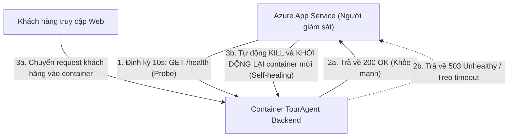
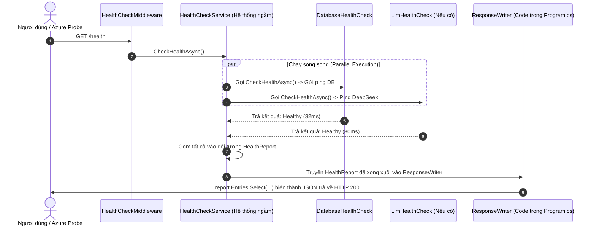

### 🎙️ Câu Trả Lời Phỏng Vấn (Gợi Ý Trả Lời Trực Tiếp)

> *"Nếu chỉ viết một Controller `[HttpGet("/health")]` trả về `Ok()` thì rất nhanh (5 dòng code), nhưng đó chỉ là **Liveness ngây thơ** (chỉ biết web server còn thức, không biết database hay các service phụ thuộc sống hay chết).*
>
> *Em chọn dùng thư viện chuẩn `Microsoft.Extensions.Diagnostics.HealthChecks` vì đây là **Industry Standard (Chuẩn công nghiệp) cho Cloud-Native**. Nó biến Health Check thành một **Pipeline tổng hợp (Aggregation)**, cho phép kiểm tra song song nhiều thành phần (DB, Redis, LLM API) với cơ chế Timeout và HTTP Status Code chuẩn (200/503) mà các hạ tầng như Azure App Service hay Kubernetes hiểu được ngay lập tức."*

---

### 🟢 TOP 3 ƯU ĐIỂM (Pros)

1. **Chuẩn hóa hạ tầng Cloud (Cloud-Native Standard)**:
   - Tự động map HTTP status code chuẩn: `200 OK` (Healthy) và `503 Service Unavailable` (Unhealthy).
   - Azure App Service, Kubernetes (K8s), AWS hay Docker Swarm đều có các cơ chế dò (Probes) dựa trên status code này để **tự động khởi động lại container bị treo hoặc ngắt tải khỏi container bị lỗi**.
2. **Khả năng mở rộng & Gắn nhãn (Aggregation & Tagging)**:
   - Dễ dàng gắn thêm nhiều probe sau này (Redis, RabbitMQ, DeepSeek API) mà không làm phình Controller.
   - Hỗ trợ tách biệt bằng Tags:
     - `/health/live` (Liveness - app còn sống không? Không check DB).
     - `/health/ready` (Readiness - DB đã kết nối được chưa? Sẵn sàng nhận request chưa?).
3. **Bảo vệ hệ thống với Timeout & Chạy song song (Circuit & Concurrency Protection)**:
   - Tích hợp sẵn `CancellationToken` và timeout riêng cho từng check. Nếu DB phản hồi chậm quá 3s, probe tự ngắt để tránh tình trạng request kiểm tra sức khỏe lại làm nghẽn luôn luồng xử lý chính.

---

### 🔴 TOP 3 ĐÁNH ĐỔI (Trade-offs)

1. **Thêm Dependency (Thêm DLL bên ngoài)**:
   - Phải tham chiếu thêm package `Microsoft.Extensions.Diagnostics.HealthChecks.Abstractions` vào tầng Infrastructure, phát sinh việc quản lý version và kích thước package (dù package này rất nhẹ, chỉ ~30KB).
2. **Boilerplate Code (Tốn công setup ban đầu)**:
   - Thay vì 1 hàm Controller đơn giản, ta phải tạo class riêng implement `IHealthCheck`, inject DbContext, cấu hình `AddHealthChecks()` và viết `ResponseWriter` trong `Program.cs`.
3. **Rủi ro tạo tải phụ lên Database (Database Load Risk)**:
   - Vì probe gửi lệnh ping `SELECT 1` xuống DB, nếu cấu hình trên Azure/K8s tần suất quá dày (ví dụ 2 giây/lần trên 10 container replicas), nó sẽ tiêu tốn một lượng connection nhất định trong PostgreSQL Connection Pool.

---

> 💡 **Mẹo ghi nhớ nhanh để phỏng vấn**:
> *"Controller tự viết chỉ biết **App sống hay chết**; Health Check Pipeline của Microsoft biết **App có làm việc được hay không**."*


- giải thích về cơ chế dò (probe) là gì?
- hiện tại chỉ đang check database. còn ví dụ nào mà sau này cần dùng nữa không? tôi vẫn chưa tưởng tượng được

### 1. Cơ Chế Dò (Probe) Là Gì?

Hãy tưởng tượng **Probe** giống như một **"bác sĩ gác cổng"** của hạ tầng đám mây (Azure / Kubernetes / Docker):

Cứ định kỳ (ví dụ mỗi **1 phút** một lần), hệ thống Azure sẽ tự động gửi một tín hiệu HTTP ngầm đến app của bạn:
👉 `GET https://touragent-api.azurewebsites.net/health`



Dựa vào phản hồi trả về:

- **Nếu trả về `200 OK`**: Azure hiểu là *"App đang khỏe mạnh"* ➔ Cho phép tiếp tục chuyển request của khách hàng vào.
- **Nếu trả về `503` hoặc bị Treo (Timeout)**: Azure hiểu là *"App bị nghẽn DB hoặc deadlock treo cứng rồi"* ➔ Azure sẽ:
  1. **Tạm ngắt**: Không đẩy request của khách vào container này nữa (tránh để khách thấy trang web bị lỗi trắng).
  2. **Tự phục hồi (Self-Healing)**: Tự động xóa (kill) container bị lỗi và bật container mới tinh lên thay thế.

---

### 2. Ngoài Database Ra, Thực Tế Người Ta Còn Check Những Gì?

Trong các hệ sinh thái thực tế (và ngay chính trong dự án **TourAgent** khi phát triển tiếp), bạn sẽ thấy các Health Check sau:

#### ① Kiểm Tra Nhà Cung Cấp AI (DeepSeek / OpenAI Health Check)

- **Bối cảnh trong TourAgent**: Backend của bạn có tính năng chat AI tư vấn du lịch gọi sang DeepSeek API.
- **Tại sao cần check?**: Nếu DeepSeek bị sập server (Outage) hoặc API Key của bạn hết tiền, người dùng bấm chat bot sẽ bị đơ.
- **Probe làm gì?**: Định kỳ gửi 1 request siêu nhẹ kiểm tra kết nối tới `https://api.deepseek.com`. Nếu fail ➔ Đánh dấu trạng thái `Degraded` (Suy giảm) để hệ thống tự chuyển sang kịch bản fallback (báo người dùng "AI đang bận, vui lòng thử lại sau").

#### ② Kiểm Tra Bộ Nhớ Đệm (Redis Cache)

- **Bối cảnh**: Sau này bạn dùng Redis để cache danh sách Tour hoặc giới hạn lượt chat (Rate Limiting).
- **Probe làm gì?**: Gửi lệnh `PING` sang Redis. Nếu Redis trả về `PONG` ➔ Khỏe mạnh. Nếu Redis sập ➔ App báo Unhealthy để điều phối viên biết.

#### ③ Kiểm Tra Hàng Đợi Tin Nhắn (RabbitMQ / Azure Service Bus)

- **Bối cảnh**: Khi khách đặt tour, hệ thống đẩy đơn hàng vào Hàng đợi (Message Queue) để xử lý xuất vé máy bay hoặc gửi mail xác nhận ngầm.
- **Probe làm gì?**: Kiểm tra kết nối tới Broker của Queue. Nếu mất kết nối ➔ Chặn nhận đơn mới để tránh thất lạc dữ liệu của khách.

#### ④ Kiểm Tra Tài Nguyên Ổ Cứng & Bộ Nhớ RAM (Disk Storage & Memory Health Check)

- **Bối cảnh**: App chạy lâu ngày sinh ra nhiều file log hoặc upload ảnh tour làm đầy ổ cứng.
- **Probe làm gì?**: Đo dung lượng ổ đĩa còn lại. Nếu ổ cứng trống dưới 5% hoặc RAM bị rò rỉ chạm ngưỡng 95% ➔ Báo động ngay cho đội DevOps trước khi toàn bộ hệ thống bị sập vì "Out of Disk / Out of Memory".

---

> 💡 **Tóm tắt trả lời phỏng vấn cực hay**:
> *"Trong một hệ thống phân tán (Distributed System), backend không đứng một mình mà phụ thuộc vào cả một chuỗi liên hoàn: DB, Redis, Message Queue và 3rd-party APIs (DeepSeek). Health Check Pipeline cho phép em giám sát toàn diện sức khỏe của cả chuỗi này tại một điểm duy nhất (`/health`), giúp Cloud tự động kích hoạt cơ chế tự phục hồi (Self-healing) khi có sự cố."*

---


tôi vừa đọc lại code có vẻ hiểu 1 chút. hãy đánh giá giúp tôi hiểu đúng không

- sau này nếu tôi muốn check api llm thì sẽ tạo 1 file là LLMHealthCheck, implement IHealthCheck. bên trong sẽ có 1 đoạn code để request đến LLM kiểm tra. đúng không?
- những câu hỏi về cơ chế chạy
  - khi request endpoint health thì code check mới chạy hay là trước đó đã chạy rồi?
  - lúc request chỉ là vào lấy report Entries? hay là khi app.MapHealthChecks thật chất là trigger gọi tất cả cả class có implement IHealthCheck? vì tôi chỉ thấy chỗ Select để lấy response nên thắc mắc không biết cơ chế chạy thật sư, khi nào code chạy
- vì tất cả class implement IHealthCheck nên chỉ cần gọi vào endpoint health thì sẽ trigger toàn bộ class, sau đó sẽ có dữ liệu của tất cả các loại check đúng không?


Bạn đã  **hiểu đúng 100% bản chất** ! Tư duy suy luận của bạn rất logic và chính xác.

Dưới đây là phân tích chi tiết để bạn nắm chắc tường tận cơ chế bên dưới của ASP.NET Core:

### 1. Ý tưởng mở rộng `LlmHealthCheck`: ĐÚNG 100%

Đúng như bạn nghĩ, sau này nếu muốn kiểm tra DeepSeek, bạn chỉ cần làm 2 bước:

1. Tạo class:
   ```csharp
   public class LlmHealthCheck : IHealthCheck
   {
       public async Task<HealthCheckResult> CheckHealthAsync(...)
       {
           // Gửi 1 request GET siêu nhẹ tới https://api.deepseek.com
           // Nếu OK -> return HealthCheckResult.Healthy();
           // Nếu lỗi -> return HealthCheckResult.Unhealthy();
       }
   }
   ```
2. Đăng ký trong `Program.cs`:
   ```csharp
   builder.Services.AddHealthChecks()
       .AddCheck<DatabaseHealthCheck>("postgresql")
       .AddCheck<LlmHealthCheck>("deepseek"); // <-- Chỉ thêm 1 dòng này!
   ```

---

### 2. Cơ Chế Chạy Thật Sự: Khi Nào Code Chạy?

> **Trả lời trực tiếp**: Khi có request gọi vào `GET /health` thì **code mới bắt đầu chạy** (chứ không phải chạy ngầm từ trước).

Đây là chu trình diễn ra bên trong hậu trường khi bạn gõ `http://localhost:5132/health`:



#### Giải thích chi tiết 4 bước trong quy trình:

1. **Bước 1 - Yêu cầu đến**: Khi request `GET /health` tới, middleware `HealthCheckMiddleware` chặn lại.
2. **Bước 2 - Kích hoạt (Trigger)**: Hệ thống ngầm (`HealthCheckService`) lục trong DI container xem có bao nhiêu class đăng ký `IHealthCheck`. Nó sẽ **kích hoạt đồng thời (song song)** hàm `CheckHealthAsync()` của từng class một.
3. **Bước 3 - Tổng hợp (Aggregate)**: Sau khi các class chạy xong và trả về kết quả, hệ thống gom tất cả lại thành một đối tượng duy nhất tên là `HealthReport`.
   - Nếu **tất cả** Healthy ➔ `report.Status = Healthy` (HTTP 200).
   - Chỉ cần **1 cái** Unhealthy ➔ `report.Status = Unhealthy` (HTTP 503).
4. **Bước 4 - Trả kết quả**: Lúc này, hàm `ResponseWriter` (đoạn code bạn thấy trong `Program.cs`) mới được gọi. Tham số `report` lúc này **đã có sẵn dữ liệu đầy đủ rồi**, việc dùng `.Select(...)` chỉ đơn giản là duyệt qua danh sách kết quả đó để đóng gói thành JSON đẹp mắt gửi về client!

---

### 3. Tóm Lại Câu Hỏi Thứ 3

> *"Chỉ cần gọi vào endpoint health thì sẽ trigger toàn bộ class, sau đó sẽ có dữ liệu của tất cả các loại check đúng không?"*

**CHÍNH XÁC 100%!**

Đó chính là lý do vì sao trong thiết kế phần mềm, cơ chế này được gọi là **Mô hình Tổng Hợp (Aggregation Pattern)**:

- Người gọi (Client / Azure) **chỉ cần biết 1 URL duy nhất** (`/health`).
- Backend tự động điều phối chạy hàng loạt các bài kiểm tra bên dưới và gom kết quả lại thành 1 báo cáo tổng thể. Bạn không bao giờ phải viết nhiều controller rời rạc kiểu `/health-db`, `/health-redis`, `/health-llm`.
